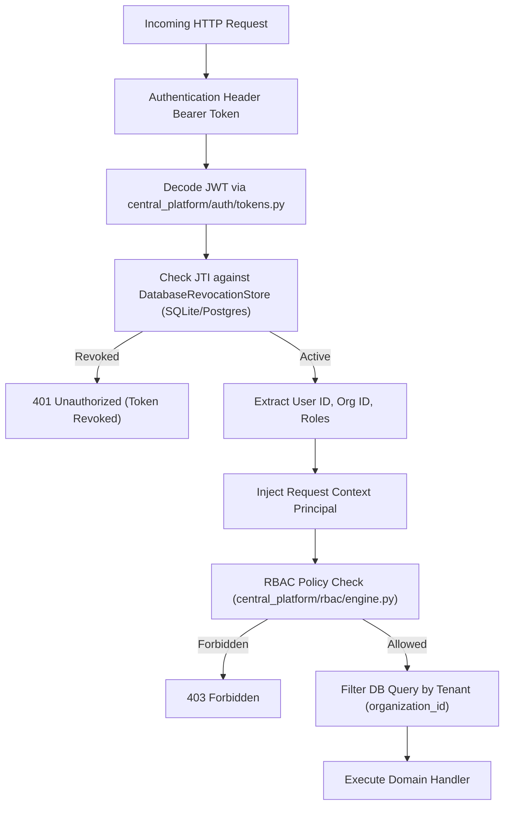
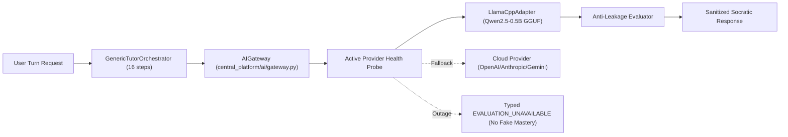

# Gayatri School OS — Comprehensive Repository Map

**Document Type:** Authoritative Source Map and Codebase Inventory  
**Reference Document:** `DEVELOPMENT.md` (Section 1.2)  
**Status:** Living Engineering Reference  
**Last Updated:** 2026-10-14  

---

## 1. Package & Entrypoint Map

| Component / Layer | Primary File / Entrypoint | Runtime / Framework | Startup Command |
|---|---|---|---|
| **Central Platform ASGI Server** | `central_platform/api/server.py` | FastAPI / Uvicorn | `python -m central_platform.api.server` |
| **FastAPI Application Factory** | `central_platform/api/app.py:create_app` | FastAPI | Loaded via ASGI server |
| **Desktop Shell** | `app/main.py` | PySide6 / QWebChannel | `python -m app.main` or `run.bat` |
| **Offline Local Runtime** | `local_runtime/session.py` | Standalone Python | Embedded in desktop shell |
| **Migration Runner** | `scripts/migrate_db.py` | Python CLI (argparse) | `python scripts/migrate_db.py up --db-path gayatri_local.db` |
| **Local Dev Launcher** | `scripts/launch_local_environment.py` | Python CLI | `python scripts/launch_local_environment.py` |
| **Llama-CPP Model Downloader** | `install_llama.py` | Python CLI / HuggingFace | `python install_llama.py` |

---

## 2. API Route Registry & Version Prefixes

All canonical platform routes are versioned under `/api/v1/*` in `central_platform/api/app.py`:

| Prefix | Router Module | Primary Operations | Label |
|---|---|---|---|
| `/api/v1/auth` | `central_platform/api/routes/auth.py` | Login, token issue, refresh, revoke, password change | `RUNTIME_VERIFIED` |
| `/api/v1/users` | `central_platform/api/routes/users.py` | User CRUD, role assignments, profile management | `RUNTIME_VERIFIED` |
| `/api/v1/organizations` | `central_platform/api/routes/organizations.py` | Multi-tenant organization provisioning and config | `RUNTIME_VERIFIED` |
| `/api/v1/classes` | `central_platform/api/routes/classes.py` | Class, batch, cohort creation and listing | `RUNTIME_VERIFIED` |
| `/api/v1/enrollments` | `central_platform/api/routes/enrollments.py` | Student class & course enrollment management | `RUNTIME_VERIFIED` |
| `/api/v1/students` | `central_platform/api/routes/students.py` | Student profile, progress, and dashboard endpoints | `RUNTIME_VERIFIED` |
| `/api/v1/teachers` | `central_platform/api/routes/teachers.py` | Teacher roster, interventions, copilot briefings | `RUNTIME_VERIFIED` |
| `/api/v1/courses` | `central_platform/api/routes/courses.py` | Course catalog, publishing, approval lifecycle | `RUNTIME_VERIFIED` |
| `/api/v1/curricula` | `central_platform/api/routes/curricula.py` | Curriculum nodes, subject taxonomies, DAG | `RUNTIME_VERIFIED` |
| `/api/v1/rag` | `central_platform/api/routes/rag.py` | Document upload, chunking, indexing, retrieval | `RUNTIME_VERIFIED` |
| `/api/v1/tutor` | `central_platform/api/routes/tutor.py` | Socratic conversational turn execution | `RUNTIME_VERIFIED` |
| `/api/v1/sessions` | `central_platform/api/routes/sessions.py` | Tutor session creation, persistence, history | `RUNTIME_VERIFIED` |
| `/api/v1/learning` | `central_platform/api/routes/learning.py` | Mastery projection, learning events, decay | `RUNTIME_VERIFIED` |
| `/api/v1/assessments` | `central_platform/api/routes/assessments.py` | Evaluator registry, rubrics, anti-leakage checks | `RUNTIME_VERIFIED` |
| `/api/v1/instructions` | `central_platform/api/routes/instructions.py` | 5-tier teacher instruction cascade management | `RUNTIME_VERIFIED` |
| `/api/v1/tools` | `central_platform/api/routes/tools.py` | Calculators, reference tools, graphing helpers | `RUNTIME_VERIFIED` |
| `/api/v1/ai` | `central_platform/api/routes/ai.py` | Model routing, gateway health, provider telemetry | `RUNTIME_VERIFIED` |
| `/api/v1/analytics` | `central_platform/api/routes/analytics.py` | Mastery distributions, cohort health, spend | `RUNTIME_VERIFIED` |
| `/api/v1/notifications`| `central_platform/api/routes/notifications.py`| Alerts for teachers, parents, and students | `RUNTIME_VERIFIED` |
| `/api/v1/sync` | `central_platform/api/routes/sync.py` | Bi-directional offline sync push and pull | `RUNTIME_VERIFIED` |
| `/api/v1/admin` | `central_platform/api/routes/admin.py` | Platform health, diagnostics, maintenance | `RUNTIME_VERIFIED` |
| `/api/v1/agents` | `central_platform/api/routes/agents.py` | Autonomous multi-agent coordination | `RUNTIME_VERIFIED` |
| `/healthz`, `/readyz` | `central_platform/api/app.py` | Liveness and fail-closed readiness probes | `RUNTIME_VERIFIED` |

---

## 3. Authentication, RBAC & Tenant-Scope Flow

- **Token Validation:** `central_platform.auth.tokens.verify_access_token`
- **Revocation Enforcement:** `central_platform.auth.tokens.DatabaseRevocationStore` (persisted in `revoked_tokens` table)
- **RBAC Roles:** `SUPER_ADMIN`, `ORG_ADMIN`, `TEACHER`, `STUDENT`, `PARENT` in `central_platform.rbac.engine`
- **Tenant Scope:** Every domain service method accepts `organization_id` and binds it as an mandatory filter parameter.

---

## 4. Database Lifecycle, Migrations & Transaction Semantics

- **Primary Abstraction:** `central_platform.db.PlatformDatabase`
- **Dialect Handling:** SQLite WAL mode by default; dialect-neutral query construction.
- **Migration Runner:** `scripts/migrate_db.py`
  - Applies ordered SQL scripts from `migrations/001_*.sql` to `008_*.sql`.
  - Reversible migrations with corresponding `*_down.sql` scripts.
  - Checksum validation prevents tampered migration history.
- **Transaction Semantics:**
  - Context manager `PlatformDatabase.transaction()` executes multi-table mutations within an atomic transaction.
  - Auto-rollback on any unhandled exception.

---

## 5. End-to-End Operational Paths

### 5.1 AI Ingestion, Inference & Model Routing

### 5.2 Scoped RAG Ingestion & Grounding
- **Upload:** Admin/Teacher uploads PDF/DOCX to `/api/v1/rag/upload`.
- **Parsing & Chunking:** `central_platform/rag/ingestion.py` extracts text, creates bounded chunks, and stores in `asset_chunks`.
- **Indexing:** Generates vectors via `sqlite-vec` plus BM25 inverted index tokens.
- **Retrieval:** Scoped by `organization_id` and `course_id`. Never leaks cross-course or cross-tenant knowledge.

### 5.3 Learning State & Mastery Projection
- **Action:** Student completes assessment turn or Socratic dialog.
- **Durable Event:** Written immediately to `student_events` table with UUID, timestamp, score, and concept tag.
- **Mastery Projection:** `central_platform.learning.mastery_engine.update_mastery()` recalculates node mastery and prerequisite DAG.
- **Decay Engine:** `central_platform.learning.spaced_review.py` applies Ebbinghaus memory curve to schedule future review intervals.

### 5.4 Finance & Razorpay Integration
- **Invoice Creation:** `central_platform.fees.manager.create_invoice()` writes to `fee_invoices` and `invoice_items`.
- **Order Creation:** Generates Razorpay order via `central_platform.payments.razorpay.RazorpayPaymentAdapter`.
- **Webhook Processing:** Signature verified with constant-time HMAC-SHA256 comparison. Idempotently marks payment `CAPTURED` and generates ledger `Receipt`.

### 5.5 Offline Synchronization
- **Outbox Enqueue:** Desktop runtime writes mutations to `LocalSyncOutbox` (`sync_outbox` table).
- **Transport:** When connectivity is detected, `SyncService` batches un-synced events and POSTs to `/api/v1/sync/push`.
- **Conflict Handling:** `SyncManager` reconciles timestamps using server-authoritative tie-breaking. Acknowledged events are cleared from the outbox.

---

## 6. ERP Target Modules & Implementation Inventory

| Module | Canonical Service (Target / Existing) | Canonical Tables | Route Registration | Status |
|---|---|---|---|---|
| **Admissions** | `central_platform/admissions/service.py` | `admission_inquiries`, `applications`, `admission_offers` | `/api/v1/admissions` | `PROPOSED` |
| **SIS** | `central_platform/students/service.py` | `users`, `student_profiles`, `guardians`, `student_guardians` | `/api/v1/students` | `PARTIAL` |
| **Academic Calendar** | `central_platform/academic/service.py` | `academic_years`, `academic_terms`, `school_calendar_events` | `/api/v1/academic` | `PARTIAL` |
| **Attendance** | `central_platform/attendance/service.py` | `attendance_sessions`, `attendance_records`, `attendance_corrections` | `/api/v1/attendance` | `PROPOSED` |
| **Timetable** | `central_platform/timetable/service.py` | `timetable_versions`, `timetable_slots`, `timetable_substitutions` | `/api/v1/timetable` | `PROPOSED` |
| **Examinations** | `central_platform/examinations/service.py`| `exam_sessions`, `assessment_blueprints`, `mark_entries`, `report_cards`| `/api/v1/examinations`| `PARTIAL` |
| **Finance** | `central_platform/fees/manager.py` | `fee_structures`, `fee_accounts`, `fee_invoices`, `payments` | `/api/v1/fees` | `RUNTIME_VERIFIED`|
| **HR & Payroll** | `central_platform/hr/service.py` | `staff_profiles`, `leave_requests`, `payroll_runs`, `payroll_items` | `/api/v1/hr` | `PROPOSED` |
| **Transport** | `central_platform/transport/service.py` | `transport_routes`, `transport_stops`, `vehicles`, `transport_allocations` | `/api/v1/transport` | `PROPOSED` |
| **Hostel** | `central_platform/hostel/service.py` | `hostel_buildings`, `hostel_rooms`, `bed_allocations`, `outpasses` | `/api/v1/hostel` | `PROPOSED` |
| **Inventory** | `central_platform/inventory/service.py` | `vendors`, `purchase_orders`, `stock_items`, `stock_movements` | `/api/v1/inventory` | `PROPOSED` |
| **Visitors** | `central_platform/visitors/service.py` | `visitors`, `gate_passes`, `visitor_audit_log` | `/api/v1/visitors` | `PROPOSED` |
| **Certificates** | `central_platform/certificates/service.py`| `certificate_templates`, `issued_certificates`, `certificate_revocations`| `/api/v1/certificates`| `PROPOSED` |
| **Communications**| `central_platform/communications/service.py`| `notification_templates`, `notification_jobs`, `delivery_receipts` | `/api/v1/notifications`| `PARTIAL` |
| **Public CMS** | `central_platform/cms/service.py` | `cms_posts`, `cms_notices`, `cms_media` | `/api/v1/cms` | `PROPOSED` |
| **Analytics** | `central_platform/analytics/service.py` | Rollup queries over learning, fees, attendance | `/api/v1/analytics` | `PARTIAL` |
| **Edge Daemon** | `edge/daemon.py` | Biometric punch queues, device bindings | `/api/v1/edge` | `PROPOSED` |
| **Operations** | `central_platform/deployment/validator.py` | Audit logs, backup manifests, system metrics | `/api/v1/admin` | `RUNTIME_VERIFIED`|
