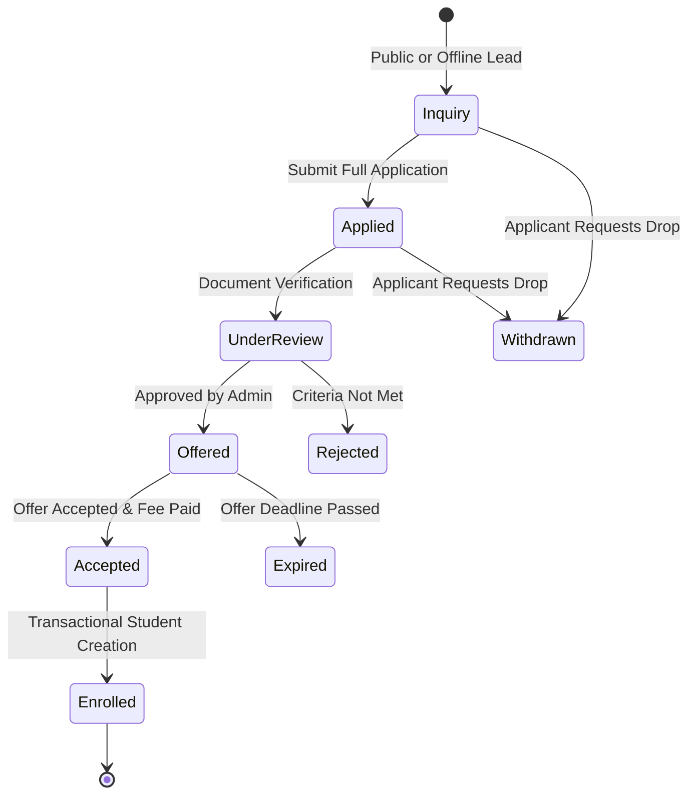

# ERP Feature Scope: Admissions & Inquiry CRM (ERP-01)

**Feature ID:** `ERP-01`  
**Governing Contract:** `DEVELOPMENT.md` (Sections 4, 14 & 15.1)  
**Parent Phase:** Phase 02B (Core ERP Foundation)  
**Status:** Approved for Implementation  
**Last Updated:** 2026-10-14  

---

## 1. Business Purpose and Beneficiaries
- **Purpose:** Manage the complete student intake lifecycle from initial prospective inquiry to application submission, document verification, interview/review, admission offer, fee link, and transactional conversion to an enrolled student profile.
- **Beneficiaries:**
  - **School/Coaching Administrators:** Track funnel health, process applications, make offers.
  - **Admissions Officers:** Review submitted documents, record interview notes, manage stage transitions.
  - **Applicants / Parents:** Submit public inquiries and formal applications, upload required proofs, receive status updates.

---

## 2. Personas and Access Matrix

| Role | Inquiry Create (Public) | Inquiry Manage | Application Review | Make Offer | Convert to Student |
|---|---|---|---|---|---|
| **Public / Anonymous** | ✅ (Rate-limited) | ❌ | ❌ | ❌ | ❌ |
| **Admission Officer** | ✅ | ✅ | ✅ | ❌ | ❌ |
| **Org Admin** | ✅ | ✅ | ✅ | ✅ | ✅ |
| **Super Admin** | ✅ | ✅ | ✅ | ✅ | ✅ |

---

## 3. Scope & Non-Scope
- **In-Scope:**
  - Public admission inquiry submission (rate-limited, sanitized).
  - Formal student application with applicant bio, previous school details, and target grade/batch.
  - Application document attachments (birth certificate, previous marksheet, photo).
  - Stage transitions: `INQUIRY` -> `APPLIED` -> `UNDER_REVIEW` -> `OFFERED` -> `ACCEPTED` -> `ENROLLED` (or `REJECTED`, `WITHDRAWN`).
  - Idempotent conversion of `ACCEPTED` application into `Person`, `StudentProfile`, `GuardianProfile`, and `StudentGuardianLink`.
- **Non-Scope (Out-of-Scope for this slice):**
  - Integrated biometric capture during interview.
  - Automatic OCR parsing of uploaded marksheets.

---

## 4. Terms and Canonical Records
- **Inquiry:** Uncommitted prospective interest record.
- **Application:** Formal legal submission with verified documents.
- **Admission Offer:** Official approval with deadline and fee conditions.
- **Conversion:** Transactional promotion of applicant record into active student profile.

---

## 5. Workflow and State Machine

---

## 6. Data Ownership & Schema (Migration 010)
- Tables owned by Admissions:
  - `admission_inquiries`
  - `admission_applications`
  - `admission_documents`
  - `admission_stage_history`
  - `admission_offers`
- Canonical Foreign Keys: `organization_id` REFERENCES `organizations(id)`, `converted_student_id` REFERENCES `student_profiles(id)`.

---

## 7. API Contract & Error Taxonomy
- `POST /api/v1/admissions/inquiries` (Public, rate-limited)
- `GET /api/v1/admissions/inquiries` (Admin/Officer)
- `POST /api/v1/admissions/applications` (Create formal application)
- `GET /api/v1/admissions/applications/{app_id}` (Get application details)
- `POST /api/v1/admissions/applications/{app_id}/transition` (Advance stage)
- `POST /api/v1/admissions/applications/{app_id}/convert` (Idempotently convert to active Student)

**Error Codes:**
- `ADMISSION_DUPLICATE_APPLICATION` (409)
- `ADMISSION_INVALID_STAGE_TRANSITION` (422)
- `ADMISSION_ALREADY_CONVERTED` (409)
- `ADMISSION_OFFER_EXPIRED` (400)

---

## 8. Threat Model & Privacy
- **Threat:** Public inquiry spam / DoS.  
  - **Mitigation:** Rate limiting on public submission endpoint, honeypot fields, and IP burst protection.
- **Threat:** Incomplete or duplicate student profiles created upon retry.  
  - **Mitigation:** Atomic database transaction wrapping student creation with unique `admission_number` constraint.
- **Threat:** Unauthorized access to applicant PII and identity documents.  
  - **Mitigation:** Document downloads require authenticated bearer token scoped to the organization.

---

## 9. Offline & Synchronization Policy
- Inquiries can be drafted offline in local outbox.
- Conversion to authoritative active student profile requires online central acknowledgment to prevent conflicting roll numbers.

---

## 10. Acceptance Criteria (Given/When/Then)
- **AC-ADM-01:** Given valid applicant data, when submitted through the admissions API, then an application is persisted in `APPLIED` state.
- **AC-ADM-02:** Given an application in `UNDER_REVIEW`, when the admin transitions it to `OFFERED`, then an offer record with expiration date is created.
- **AC-ADM-03:** Given an accepted offer, when converted, then `persons`, `student_profiles`, and guardian records are transactionally created, and re-attempting conversion returns `ADMISSION_ALREADY_CONVERTED` without duplicating student IDs.
