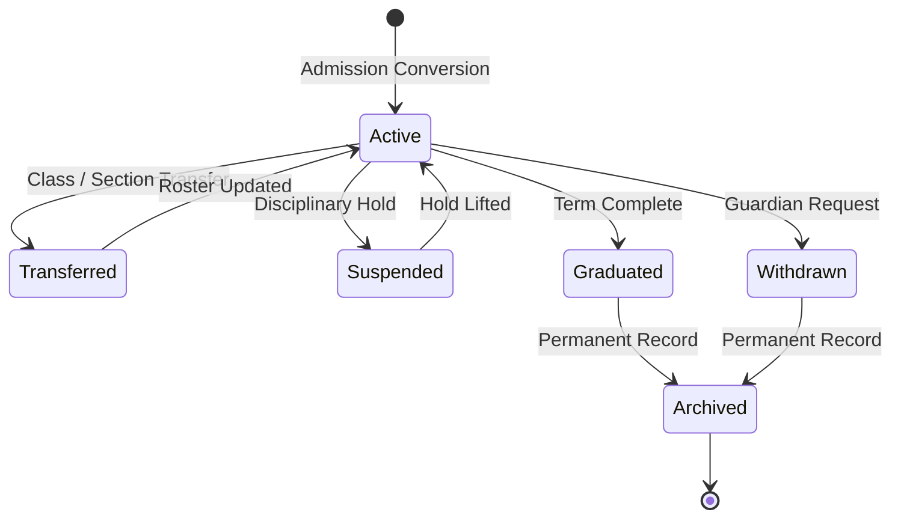

# ERP Feature Scope: Student Information System & Guardian Management (ERP-02)

**Feature ID:** `ERP-02`  
**Governing Contract:** `DEVELOPMENT.md` (Sections 4, 14 & 15.2)  
**Parent Phase:** Phase 02B (Core ERP Foundation)  
**Status:** Approved for Implementation  
**Last Updated:** 2026-10-14  

---

## 1. Business Purpose and Beneficiaries
- **Purpose:** Serve as the authoritative single source of truth for student demographic, contact, guardian, enrollment, status history, and document records.
- **Beneficiaries:**
  - **School Administration:** Maintain official records, manage class transfers, verify guardian authorizations.
  - **Teachers:** Access student rosters, emergency contacts, authorized guardian pickup lists.
  - **Parents / Guardians:** Maintain verified relationships, pickup authorizations, receive student updates through portal.
  - **Students:** View academic profile, enrollment status, attendance, and learning progress.

---

## 2. Personas and Access Matrix

| Role | View Own Profile | View Class Roster | Edit Student Bio | Manage Guardian Links | Archive / Transfer |
|---|---|---|---|---|---|
| **Student** | ✅ | ❌ | ❌ | ❌ | ❌ |
| **Parent/Guardian** | ✅ (Linked Only) | ❌ | ❌ | ❌ | ❌ |
| **Teacher** | ❌ | ✅ (Assigned Only)| ❌ | ❌ | ❌ |
| **Org Admin** | ✅ | ✅ | ✅ | ✅ | ✅ |
| **Super Admin** | ✅ | ✅ | ✅ | ✅ | ✅ |

---

## 3. Scope & Non-Scope
- **In-Scope:**
  - Extended student profile fields: blood group, allergies, emergency contacts, medical notes.
  - Multi-guardian relationships with fine-grained authorization flags (`is_pickup_authorized`, `is_emergency_contact`, `can_access_portal`).
  - Class and batch transfer with immutable historical log (`student_transfer_history`).
  - Student status lifecycle (`active`, `suspended`, `transferred`, `graduated`, `withdrawn`, `archived`).
  - Multi-tenant roster search, advanced filtering, and exportable CSV/JSON records.
- **Non-Scope:**
  - Biometric facial recognition for pickup verification (scheduled for Phase 07).

---

## 4. State Machine & Transitions

---

## 5. Data Entities & Schema Extension
- Tables:
  - `student_profiles` (extended in Migration 009/010)
  - `guardian_profiles` (created in Migration 009)
  - `student_guardian_links` (created in Migration 009)
  - `student_status_history` (tracks date, previous status, new status, actor, reason)
  - `student_transfer_history` (tracks from_class, to_class, effective_date, approved_by)

---

## 6. Privacy, Access & Data Retention
- National IDs (Aadhaar/SSN hash) must be stored hashed or masked; never rendered in plain text to unauthorized viewers.
- Medical notes and allergy alerts are restricted to assigned teachers and health staff.
- Unlinking a guardian immediately terminates portal session access to student records.

---

## 7. Acceptance Criteria (Given/When/Then)
- **AC-SIS-01:** Given an active student, when linked to multiple guardians, then each guardian has independent pickup and portal access flags.
- **AC-SIS-02:** Given a student transfer from Section 10A to Section 10B, then `student_transfer_history` durably records the change and teacher access is updated immediately.
- **AC-SIS-03:** Given a parent attempting to access an unlinked student's records, then the system returns HTTP 403 Forbidden with zero data leakage.
