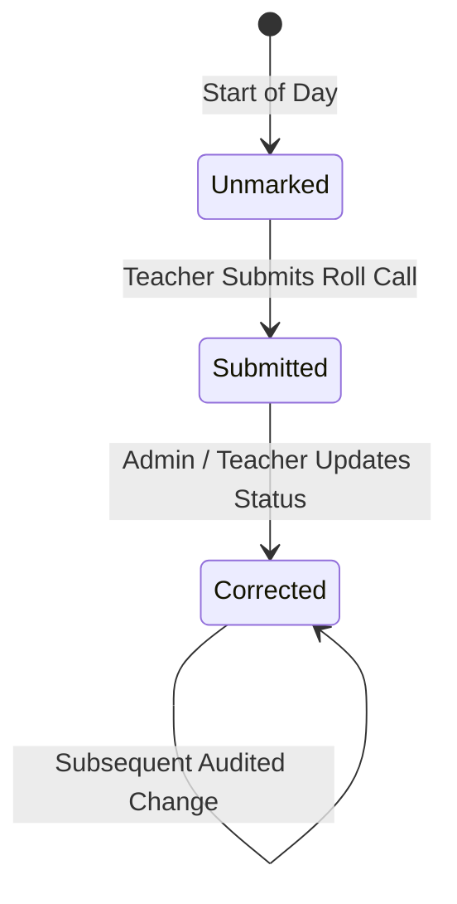

# ERP Feature Scope: Student & Staff Attendance Tracking (ERP-04)

**Feature ID:** `ERP-04`  
**Governing Contract:** `DEVELOPMENT.md` (Sections 4, 6.4 & Phase 03)  
**Parent Phase:** Phase 03 (Attendance, Timetable & Communications Foundation)  
**Status:** In Preparation  
**Last Updated:** 2026-10-14  

---

## 1. Business Purpose and Beneficiaries
- **Purpose:** Provide daily operational attendance marking for classes and batches with auditable corrections, session definitions (morning/afternoon/full-day), absence tracking, excuse management, and automated parent absence alert triggers.
- **Beneficiaries:**
  - **Teachers:** Mark roll-call attendance rapidly for their assigned classes/batches.
  - **School Administrators:** Monitor school-wide attendance rates, approve excused absences, view correction logs.
  - **Parents:** Real-time visibility into ward arrival, departure, and absence alerts.

---

## 2. Personas and Access Matrix

| Role | Mark Attendance | Submit Correction | Approve Correction | View Class Report | View Individual Record |
|---|---|---|---|---|---|
| **Student** | ❌ | ❌ | ❌ | ❌ | ✅ (Self only) |
| **Parent** | ❌ | ❌ (Submit Excuse) | ❌ | ❌ | ✅ (Ward only) |
| **Teacher** | ✅ (Assigned) | ✅ | ❌ | ✅ (Assigned) | ✅ (Assigned) |
| **Org Admin** | ✅ | ✅ | ✅ | ✅ | ✅ |

---

## 3. Scope & Non-Scope
- **In-Scope:**
  - Session definition (`MORNING`, `AFTERNOON`, `FULL_DAY`, `PERIOD_WISE`).
  - Attendance statuses: `PRESENT`, `ABSENT`, `LATE`, `HALF_DAY`, `EXCUSED`, `MEDICAL_LEAVE`.
  - Daily roll call marking for classes/sections and coaching batches.
  - Idempotent bulk submission by class and date.
  - Auditable correction ledger (`previous_status`, `new_status`, `reason`, `corrected_by`).
  - Absence notifications queued to outbox upon commit.
- **Non-Scope:**
  - Direct hardware biometric edge clock sync (reserved for Phase 07).
  - Geofenced mobile app beacon detection.

---

## 4. Terms and Canonical Records
- **Attendance Session:** Defined business day or period slot for which roll call is recorded.
- **Roll Call:** Collective attendance submission for a class/batch.
- **Attendance Correction:** Immutable log of any status modification after commit.

---

## 5. Workflow and State Machine

---

## 6. Data Entities (Migration 011 candidate)
1. `attendance_sessions` (id, organization_id, academic_year_id, class_id, date, session_type, status, taken_by, created_at, updated_at).
2. `attendance_records` (id, organization_id, session_id, student_id, status, arrival_time, remarks, created_at, updated_at, UNIQUE(session_id, student_id)).
3. `attendance_corrections` (id, organization_id, record_id, previous_status, new_status, reason, corrected_by, created_at).
4. `absence_excuse_requests` (id, organization_id, student_id, start_date, end_date, reason, status, approved_by, created_at, updated_at).
