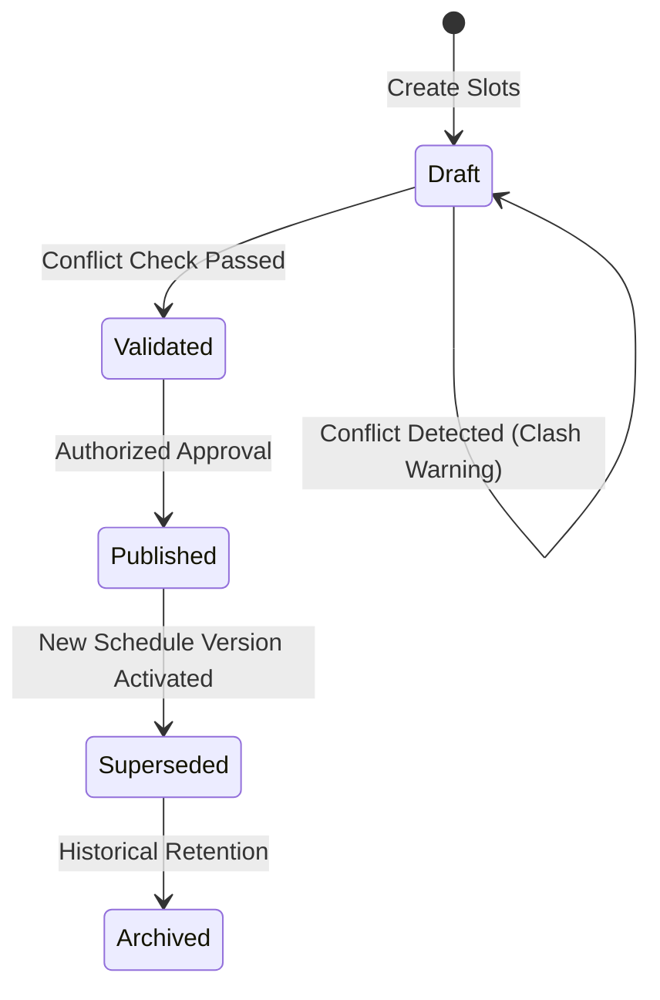

# ERP Feature Scope: Timetable & Schedule Management (ERP-05)

**Feature ID:** `ERP-05`  
**Governing Contract:** `DEVELOPMENT.md` (Sections 4, 6.5 & Phase 03)  
**Parent Phase:** Phase 03 (Attendance, Timetable & Communications Foundation)  
**Status:** In Preparation  
**Last Updated:** 2026-10-14  

---

## 1. Business Purpose and Beneficiaries
- **Purpose:** Manage class, section, batch, teacher, and room scheduling. Detect and prevent teacher and room double-booking conflicts, support draft-to-published timetable versioning, and handle daily teacher substitutions.
- **Beneficiaries:**
  - **Academic Coordinators / Timetable In-charge:** Generate and publish schedules, detect clashes.
  - **Teachers:** View daily teaching schedules, period rooms, and substitution assignments.
  - **Students / Parents:** View daily and weekly class routine.

---

## 2. Personas and Access Matrix

| Role | Create Schedule | Publish Schedule | Assign Substitution | View Schedule |
|---|---|---|---|---|
| **Student** | ❌ | ❌ | ❌ | ✅ (Class only) |
| **Parent** | ❌ | ❌ | ❌ | ✅ (Ward's class) |
| **Teacher** | ❌ | ❌ | ❌ | ✅ (Assigned) |
| **Academic Coordinator** | ✅ | ✅ | ✅ | ✅ |
| **Org Admin** | ✅ | ✅ | ✅ | ✅ |

---

## 3. Scope & Non-Scope
- **In-Scope:**
  - Timetable structure: Period definitions (start_time, end_time, period_number).
  - Weekly schedule slots (day_of_week, period_id, class_id, subject_id, teacher_id, room_id).
  - Conflict detection:
    - Teacher clash (teacher assigned to two classes simultaneously).
    - Room clash (room assigned to two classes simultaneously).
    - Class clash (class assigned two subjects simultaneously).
  - Lifecycle: `DRAFT` -> `VALIDATED` -> `PUBLISHED` -> `SUPERSEDED` -> `ARCHIVED`.
  - Daily substitution logging (`original_teacher_id`, `substitute_teacher_id`, `date`, `slot_id`).
- **Non-Scope:**
  - Automatic AI-based genetic algorithm timetable generator (reserved for future optimization).

---

## 4. Terms and Canonical Records
- **Timetable Period:** Standard time slot in a school day (e.g. Period 1: 08:30 - 09:15).
- **Schedule Slot:** Association of Day + Period + Class + Subject + Teacher + Room.
- **Substitution:** Daily temporary reassignment of a schedule slot to another teacher.

---

## 5. Workflow and State Machine

---

## 6. Data Entities (Migration 011 candidate)
1. `timetable_periods` (id, organization_id, academic_year_id, name, period_number, start_time, end_time, is_break, created_at).
2. `class_timetable_slots` (id, organization_id, academic_year_id, class_id, period_id, day_of_week, subject_id, teacher_id, room_name, status, created_at, updated_at).
3. `teacher_substitutions` (id, organization_id, slot_id, date, original_teacher_id, substitute_teacher_id, reason, status, created_at).
