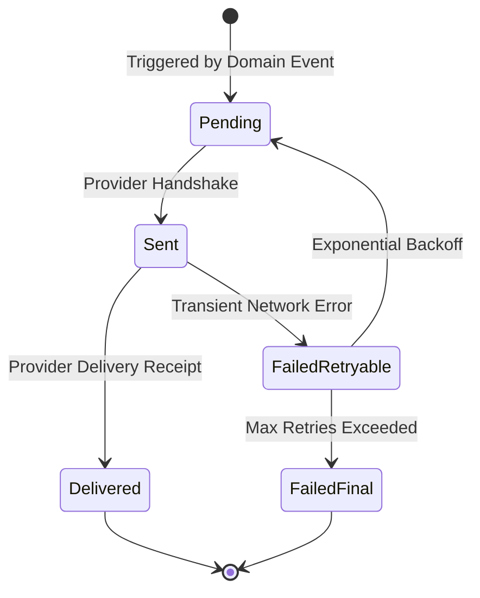

# ERP Feature Scope: Communications & Notification Gateway (ERP-06)

**Feature ID:** `ERP-06`  
**Governing Contract:** `DEVELOPMENT.md` (Sections 4, 6.6 & Phase 03)  
**Parent Phase:** Phase 03 (Attendance, Timetable & Communications Foundation)  
**Status:** In Preparation  
**Last Updated:** 2026-10-14  

---

## 1. Business Purpose and Beneficiaries
- **Purpose:** Centralized, durable outbound communication service for multi-channel notifications (in-app alerts, SMS, email, WhatsApp, push) with delivery tracking, retry policies, and template-based messaging.
- **Beneficiaries:**
  - **School Administration:** Broadcast circulars, emergency announcements, holiday alerts.
  - **Teachers:** Direct messages regarding homework, performance notices, attendance updates.
  - **Parents & Students:** Receive instant alerts regarding attendance, fees, exams, and bus delays.

---

## 2. Personas and Access Matrix

| Role | Broadcast Notice | Send Targeted Message | View Outbox / Logs | View My Notifications |
|---|---|---|---|---|
| **Student** | ❌ | ❌ | ❌ | ✅ |
| **Parent** | ❌ | ❌ | ❌ | ✅ |
| **Teacher** | ❌ | ✅ (Assigned Class) | ❌ | ✅ |
| **Org Admin** | ✅ | ✅ | ✅ | ✅ |

---

## 3. Scope & Non-Scope
- **In-Scope:**
  - In-app notification delivery and read status tracking (`UNREAD`, `READ`, `DISMISSED`).
  - Durable notification queue / outbox records with attempt tracking (`PENDING`, `SENT`, `DELIVERED`, `FAILED_RETRYABLE`, `FAILED_FINAL`).
  - Template repository (e.g. `attendance_absence_alert`, `admission_offer_issued`, `fee_due_reminder`).
  - Multi-recipient dispatch (individual, class-wide, tenant-wide broadcast).
- **Non-Scope:**
  - Live bilateral chat messaging / group WhatsApp channel administration.

---

## 4. Terms and Canonical Records
- **Notification Template:** Parametric message template with placeholder substitution.
- **Notification Dispatch:** Individual delivery record per recipient and channel.

---

## 5. Workflow and State Machine

---

## 6. Data Entities (Migration 011 candidate)
1. `notification_templates` (id, organization_id, template_code, channel, subject_template, body_template, is_active, created_at, updated_at).
2. `notification_dispatches` (id, organization_id, template_id, recipient_user_id, channel, destination, rendered_body, status, error_details, attempts, sent_at, created_at).
