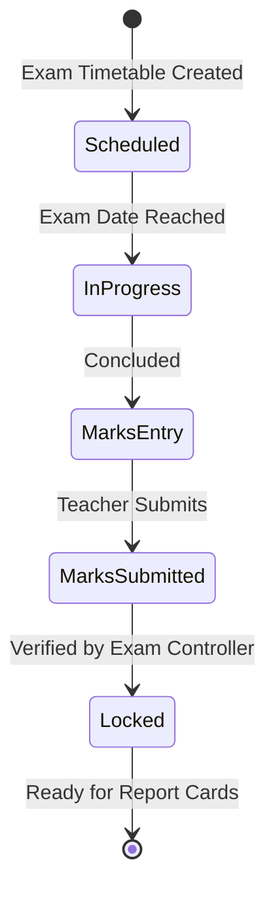

# ERP Feature Scope: Examination & Assessment Operations (ERP-07)

**Feature ID:** `ERP-07`  
**Governing Contract:** `DEVELOPMENT.md` (Sections 4, 6.7 & Phase 04)  
**Parent Phase:** Phase 04 (Examinations, Official Grading & Report Cards)  
**Status:** In Preparation  
**Last Updated:** 2026-10-14  

---

## 1. Business Purpose and Beneficiaries
- **Purpose:** Manage formal school and coaching exam scheduling, exam room allocations, invigilation duties, question paper distribution tracking, marks entry, and double-entry marks verification.
- **Beneficiaries:**
  - **Exam Controllers / Academic Heads:** Schedule exam series, allocate rooms and invigilators.
  - **Teachers / Invigilators:** Record attendance, enter exam marks within strict deadlines.
  - **Students / Parents:** View exam timetables, room assignments, and hall tickets.

---

## 2. Personas and Access Matrix

| Role | Schedule Exam | Allocate Rooms | Enter Marks | Finalize / Lock Marks | View Hall Ticket |
|---|---|---|---|---|---|
| **Student** | ❌ | ❌ | ❌ | ❌ | ✅ |
| **Parent** | ❌ | ❌ | ❌ | ❌ | ✅ (Ward) |
| **Teacher** | ❌ | ❌ | ✅ (Assigned) | ❌ | ❌ |
| **Exam Controller** | ✅ | ✅ | ✅ | ✅ | ✅ |
| **Org Admin** | ✅ | ✅ | ✅ | ✅ | ✅ |

---

## 3. Scope & Non-Scope
- **In-Scope:**
  - Exam Series (`MID_TERM`, `FINAL`, `UNIT_TEST`, `MOCK_ENTRANCE`).
  - Exam Schedule items (date, start_time, end_time, subject_id, max_marks, pass_marks).
  - Room and seat allocations.
  - Teacher marks entry with validation (bounds check: `0 <= marks <= max_marks`).
  - Marks lifecycle: `DRAFT` -> `SUBMITTED` -> `VERIFIED` -> `LOCKED`.
- **Non-Scope:**
  - OMR scanner image parsing.
  - On-screen digital handwriting annotation.

---

## 4. Terms and Canonical Records
- **Exam Series:** Major academic assessment milestone (e.g., Term 1 Final 2026).
- **Exam Paper / Schedule:** Specific subject sitting (e.g., Mathematics, 3 hours, 100 max marks).
- **Marks Entry:** Raw scores entered per student with presence status (`PRESENT`, `ABSENT`, `EXEMPT`).

---

## 5. Workflow and State Machine

---

## 6. Data Entities (Migration 012 candidate)
1. `exam_series` (id, organization_id, academic_year_id, academic_term_id, name, code, start_date, end_date, status, created_at, updated_at).
2. `exam_schedules` (id, organization_id, exam_series_id, class_id, subject_id, exam_date, start_time, end_time, max_marks, pass_marks, room_name, created_at, updated_at).
3. `exam_student_marks` (id, organization_id, schedule_id, student_id, marks_obtained, is_absent, is_exempt, remarks, status, entered_by, verified_by, created_at, updated_at, UNIQUE(schedule_id, student_id)).
