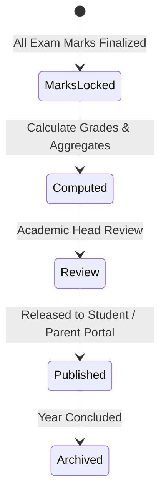

# ERP Feature Scope: Grading Scales, Report Cards & Transcripts (ERP-08)

**Feature ID:** `ERP-08`  
**Governing Contract:** `DEVELOPMENT.md` (Sections 4, 6.7 & Phase 04)  
**Parent Phase:** Phase 04 (Examinations, Official Grading & Report Cards)  
**Status:** In Preparation  
**Last Updated:** 2026-10-14  

---

## 1. Business Purpose and Beneficiaries
- **Purpose:** Compute official academic grades using versioned institutional grading policies (CBSE 9-point, percentage, GPA 4.0/10.0), aggregate term results, and generate durable, tamper-evident digital report cards and transcripts.
- **Beneficiaries:**
  - **Principals / Academic Heads:** Publish authoritative report cards with remarks.
  - **Teachers:** Enter co-scholastic remarks, review computed grades.
  - **Students / Parents:** View and download verified report cards.

---

## 2. Personas and Access Matrix

| Role | Configure Grading Scale | Calculate Term Results | Publish Report Cards | View / Download Report Card |
|---|---|---|---|---|
| **Student** | ❌ | ❌ | ❌ | ✅ (Self only) |
| **Parent** | ❌ | ❌ | ❌ | ✅ (Ward only) |
| **Teacher** | ❌ | ❌ | ❌ | ✅ (Class) |
| **Academic Head** | ✅ | ✅ | ✅ | ✅ |
| **Org Admin** | ✅ | ✅ | ✅ | ✅ |

---

## 3. Scope & Non-Scope
- **In-Scope:**
  - Configurable Grading Scales (e.g., A1, A2, B1, B2, C1, C2, D, E1, E2 with min/max percentage and grade points).
  - Versioned grading rules attached to institutional records.
  - Grade computation: percentage, total marks, GPA, rank/percentile.
  - Report Card Generation:
    - Subject-wise scores, grades, teacher remarks, attendance summary.
    - Status: `DRAFT` -> `REVIEWED` -> `PUBLISHED` -> `ARCHIVED`.
    - Tamper-evident checksum hash for verification.
- **Non-Scope:**
  - Custom drag-and-drop WYSIWYG report card designer.

---

## 4. Terms and Canonical Records
- **Grading Scale:** Rulebook mapping numerical marks to letter grades and grade points.
- **Student Term Result:** Pre-computed aggregated academic outcome per student per term.
- **Report Card:** Official document summary published to parents/students.

---

## 5. Workflow and State Machine

---

## 6. Data Entities (Migration 012 candidate)
1. `grading_scales` (id, organization_id, name, code, scale_type, created_at, updated_at).
2. `grading_scale_tiers` (id, organization_id, scale_id, grade_name, grade_point, min_percentage, max_percentage, description).
3. `student_term_results` (id, organization_id, student_id, academic_year_id, academic_term_id, total_marks_obtained, total_max_marks, percentage, gpa, final_grade, rank, created_at, updated_at, UNIQUE(student_id, academic_term_id)).
4. `student_report_cards` (id, organization_id, student_id, academic_year_id, academic_term_id, report_number, issue_date, status, general_remarks, document_hash, published_at, created_at, updated_at).
