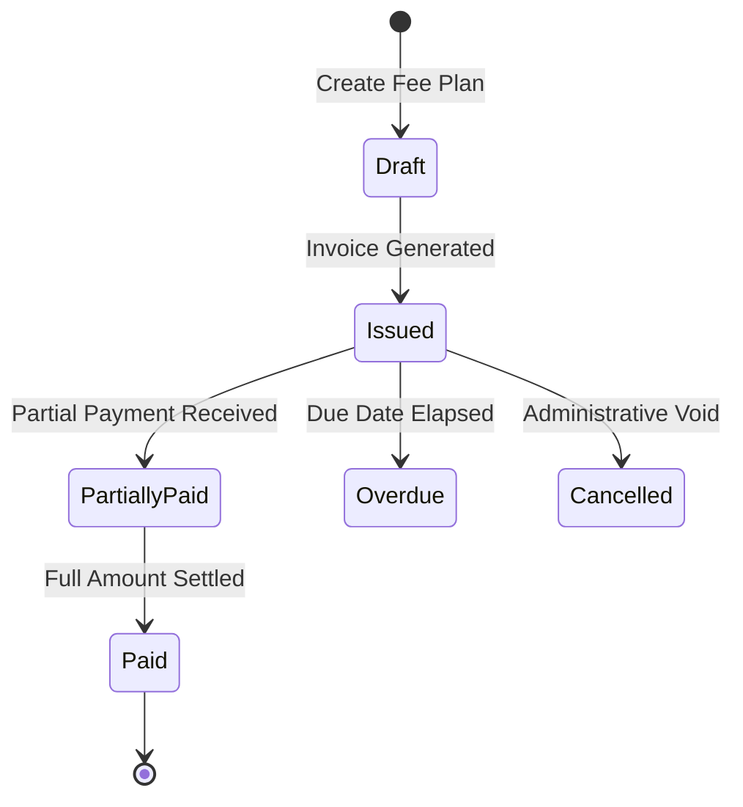

# ERP Feature Scope: Fee Structures, Invoicing & Concessions (ERP-09)

**Feature ID:** `ERP-09`  
**Governing Contract:** `DEVELOPMENT.md` (Sections 4, 6.7 & Phase 05)  
**Parent Phase:** Phase 05 (Finance, Real Payment Integrations & Reconciliation)  
**Status:** In Preparation  
**Last Updated:** 2026-10-14  

---

## 1. Business Purpose and Beneficiaries
- **Purpose:** Authoritatively define institutional fee structures (tuition, transport, lab, mess), assign fee plans to student accounts, generate itemized term invoices, and process formal fee concession approvals.
- **Beneficiaries:**
  - **Finance Officers / Accountants:** Define fee catalog, generate batch invoices, review balance ledgers.
  - **Principals / Management:** Approve fee concessions, scholarship waivers, and write-offs.
  - **Parents / Students:** View itemized bills, due dates, breakdown of fees and fee concession adjustments.

---

## 2. Personas and Access Matrix

| Role | Create Fee Structures | Issue Invoices | Request Concession | Approve Concession | View Ledger / Balance |
|---|---|---|---|---|---|
| **Student** | ❌ | ❌ | ❌ | ❌ | ✅ (Self only) |
| **Parent** | ❌ | ❌ | ❌ | ❌ | ✅ (Ward only) |
| **Teacher** | ❌ | ❌ | ❌ | ❌ | ❌ |
| **Finance Officer** | ✅ | ✅ | ✅ | ❌ | ✅ |
| **Org Admin** | ✅ | ✅ | ✅ | ✅ | ✅ |

---

## 3. Scope & Non-Scope
- **In-Scope:**
  - Versioned Fee Structures (`TUITION`, `ADMISSION`, `EXAM`, `TRANSPORT`, `HOSTEL`).
  - Fee Plans with installments count and recurrence (`ONE_TIME`, `MONTHLY`, `QUARTERLY`, `ANNUAL`).
  - Student Fee Accounts and dynamic balance derivation.
  - Itemized Invoice generation with strict dates, status tracking (`ISSUED`, `PAID`, `PARTIALLY_PAID`, `OVERDUE`, `CANCELLED`).
  - Fee Concessions & Scholarship workflow (`PENDING` -> `APPROVED` -> `REJECTED`).
  - Full multi-tenant isolation (`organization_id`).
- **Non-Scope:**
  - GST e-invoicing portal direct tax filing integration.
  - Physical POS hardware swipe terminal drivers.

---

## 4. Terms and Canonical Records
- **Fee Structure:** Canonical price unit for a school service.
- **Fee Plan:** Grouping of multiple structures into installment schedules.
- **Fee Account:** Aggregated student financial ledger account.
- **Invoice:** Official legally binding demand notice for fee payment.
- **Concession:** Approved reduction or scholarship applied to fee structures.

---

## 5. Workflow and State Machine

---

## 6. Data Entities (Migration 013 candidate)
1. `fee_concessions` (id, organization_id, student_id, fee_structure_id, concession_type, amount_or_percentage, reason, status, approved_by, approved_at, created_at, updated_at).
2. Extensions to existing `fee_structures`, `fee_plans`, `fee_accounts`, `invoices` with strict multi-tenant foreign keys and audit timestamps.
