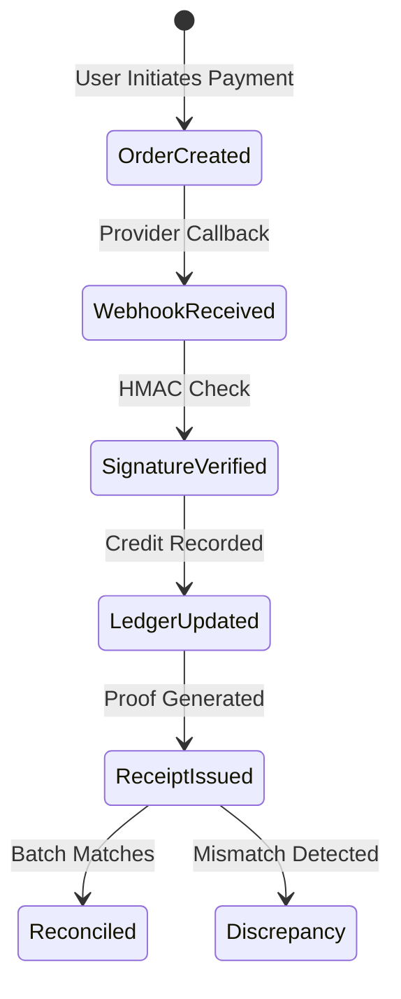

# ERP Feature Scope: Payments, Gateway Webhooks & Reconciliation (ERP-10)

**Feature ID:** `ERP-10`  
**Governing Contract:** `DEVELOPMENT.md` (Sections 4, 6.7 & Phase 05)  
**Parent Phase:** Phase 05 (Finance, Real Payment Integrations & Reconciliation)  
**Status:** In Preparation  
**Last Updated:** 2026-10-14  

---

## 1. Business Purpose and Beneficiaries
- **Purpose:** Securely process online and offline payments, verify gateway webhook signatures, prevent double-capture or replay attacks, log an append-only financial ledger, and reconcile gateway settlement batches against institutional bank accounts.
- **Beneficiaries:**
  - **Finance Officers / Bursar:** Reconcile gateway settlements, record offline cash/cheque entries, track unpaid balances.
  - **Parents / Guardians:** Pay online via UPI/Cards/Netbanking with instant tamper-evident digital receipts.
  - **Auditors:** Review complete, append-only financial audit trails where no financial records can be silently deleted or rewritten.

---

## 2. Personas and Access Matrix

| Role | Initiate Online Payment | Record Offline Payment | Process Refund | Run Reconciliation | View Receipts |
|---|---|---|---|---|---|
| **Student** | ✅ | ❌ | ❌ | ❌ | ✅ (Self only) |
| **Parent** | ✅ | ❌ | ❌ | ❌ | ✅ (Ward only) |
| **Finance Officer** | ❌ | ✅ | ✅ | ✅ | ✅ |
| **Org Admin** | ❌ | ✅ | ✅ | ✅ | ✅ |

---

## 3. Scope & Non-Scope
- **In-Scope:**
  - Payment Order lifecycle (`CREATED` -> `AUTHORIZED` -> `CAPTURED` -> `FAILED`).
  - Webhook deduplication using `event_id` and idempotency keys.
  - Server-authoritative HMAC-SHA256 webhook signature validation.
  - Append-only Financial Ledger (`financial_ledger_entries`) recording DEBIT and CREDIT transactions.
  - Automated Receipt generation with unique receipt numbers for confirmed/reconciled payments only.
  - Refund lifecycle with balance checks (`PENDING` -> `PROCESSED` -> `REJECTED`).
  - Reconciliation batch processing flagging discrepancy amounts.
- **Non-Scope:**
  - Cardholder primary account number (PAN) storage (strictly tokenized via PCI-DSS compliant gateways).

---

## 4. Terms and Canonical Records
- **Payment Order:** Server-created intent to collect funds.
- **Webhook Event:** Inbound asynchronous message from payment provider.
- **Financial Ledger Entry:** Immutable transactional credit or debit record.
- **Reconciliation Run:** Comparison of bank/gateway settlements against issued receipts.

---

## 5. Workflow and State Machine

---

## 6. Data Entities (Migration 013 candidate)
1. `payment_orders` (id, organization_id, invoice_id, student_id, amount, currency, provider, provider_order_id, status, idempotency_key, created_at, expires_at).
2. `payment_webhook_events` (id, organization_id, provider, event_id, event_type, idempotency_key, payload_hash, signature_verified, status, processed_at, created_at).
3. `financial_ledger_entries` (id, organization_id, account_id, invoice_id, payment_id, entry_type, amount, balance_after, description, created_at).
4. `reconciliation_records` (id, organization_id, run_date, provider, total_expected, total_settled, discrepancy_amount, status, notes, reconciled_by, created_at).
