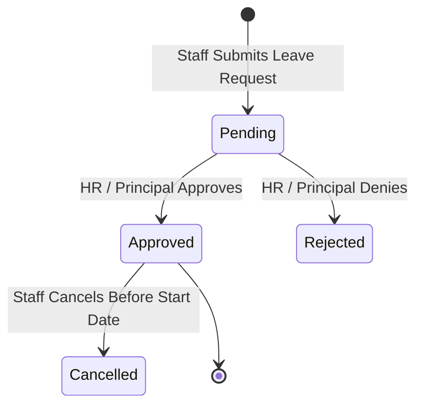

# ERP Feature Scope: Staff, HR & Leave Management (ERP-11)

**Feature ID:** `ERP-11`  
**Governing Contract:** `DEVELOPMENT.md` (§6.8, §7 Phase 06)  
**Parent Phase:** Phase 06 (Full ERP Expansion)  
**Status:** In Preparation  
**Last Updated:** 2026-10-15  

---

## 1. Business Purpose and Beneficiaries
- **Purpose:** Manage staff profiles, employee contracts, leave quotas/balances, leave applications/approvals, and daily staff attendance tracking with auditable corrections.
- **Beneficiaries:**
  - **School HR / Principal:** Approve leave requests, review staff attendance, track teacher allocations.
  - **Teachers / Non-Teaching Staff:** Submit leave requests, view remaining leave balances, track punch status.

---

## 2. Personas and Access Matrix

| Role | Submit Leave Request | Approve Leave | Mark Staff Attendance | Correct Staff Attendance | View Staff Directory |
|---|---|---|---|---|---|
| **Staff/Teacher** | ✅ (Self) | ❌ | ❌ | ❌ | ✅ |
| **HR Officer** | ✅ | ✅ | ✅ | ✅ | ✅ |
| **Org Admin** | ✅ | ✅ | ✅ | ✅ | ✅ |

---

## 3. Scope & Non-Scope
- **In-Scope:**
  - Leave categories: `CASUAL`, `SICK`, `EARNED`, `MATERNITY`, `PATERNITY`, `UNPAID`.
  - Leave lifecycle: `PENDING` -> `APPROVED` -> `REJECTED` -> `CANCELLED`.
  - Overlapping date validations preventing double-booking leaves.
  - Daily staff attendance recording (`PRESENT`, `ABSENT`, `HALF_DAY`, `ON_DUTY`) with time logging.
  - Strict multi-tenant isolation (`organization_id`).
- **Non-Scope:**
  - Direct biometric hardware punch driver (handled via edge sync daemon in Phase 07).

---

## 4. Terms and Canonical Records
- **Staff Profile:** Master employee record linked to identity user.
- **Staff Leave Request:** Formal absence application specifying date range and reason.
- **Staff Attendance Record:** Daily presence verification per staff member.

---

## 5. Workflow and State Machine

---

## 6. Data Entities (Migration 014 candidate)
1. `staff_leave_requests` (id, organization_id, staff_id, leave_type, start_date, end_date, total_days, reason, status, approved_by, approved_at, rejection_reason, created_at, updated_at).
2. `staff_attendance_records` (id, organization_id, staff_id, date, status, check_in_time, check_out_time, remarks, created_at, updated_at, UNIQUE(organization_id, staff_id, date)).
