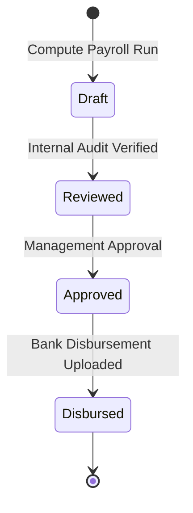

# ERP Feature Scope: Payroll Preparation & Compensation (ERP-12)

**Feature ID:** `ERP-12`  
**Governing Contract:** `DEVELOPMENT.md` (§6.8, §7 Phase 06)  
**Parent Phase:** Phase 06 (Full ERP Expansion)  
**Status:** In Preparation  
**Last Updated:** 2026-10-15  

---

## 1. Business Purpose and Beneficiaries
- **Purpose:** Compute deterministic monthly payroll runs, calculate basic salary, allowances (HRA, DA, Special), deductions (PF, ESI, TDS, Unpaid Leave), generate payslips, and produce bank disbursement export manifests.
- **Beneficiaries:**
  - **Accountant / Payroll Officer:** Create payroll runs, verify calculations, export bank payment files.
  - **Principal / Trust Secretary:** Review and approve finalized payroll runs.
  - **Employees / Teachers:** View and download monthly payslips with exact component breakdowns.

---

## 2. Personas and Access Matrix

| Role | Create Payroll Run | Approve Payroll Run | View Employee Payslip | Export Disbursement File |
|---|---|---|---|---|
| **Employee** | ❌ | ❌ | ✅ (Self only) | ❌ |
| **Payroll Officer** | ✅ | ❌ | ✅ | ✅ |
| **Org Admin** | ✅ | ✅ | ✅ | ✅ |

---

## 3. Scope & Non-Scope
- **In-Scope:**
  - Payroll periods (e.g. `2026-10`, `month=10`, `year=2026`).
  - Payroll run states: `DRAFT` -> `REVIEWED` -> `APPROVED` -> `DISBURSED`.
  - Itemized employee payslip records with gross pay, allowances, deductions, and net pay.
  - Deduction calculation considering unpaid leave days from staff attendance.
- **Non-Scope:**
  - Automated RBI NEFT/RTGS host-to-host direct clearing without human authorization.

---

## 4. Terms and Canonical Records
- **Payroll Period:** Accounting month for staff compensation.
- **Payroll Run:** Aggregate batch calculation instance for an institution in a period.
- **Payslip:** Authoritative compensation voucher issued to an individual employee.

---

## 5. Workflow and State Machine

---

## 6. Data Entities (Migration 014 candidate)
1. `payroll_periods` (id, organization_id, name, year, month, start_date, end_date, status, created_at, updated_at).
2. `payroll_runs` (id, organization_id, payroll_period_id, total_gross, total_deductions, total_net, employee_count, status, created_by, approved_by, approved_at, created_at, updated_at).
3. `payslips` (id, organization_id, payroll_run_id, staff_id, basic_salary, allowances_json, deductions_json, gross_amount, net_amount, payment_status, created_at, updated_at).
