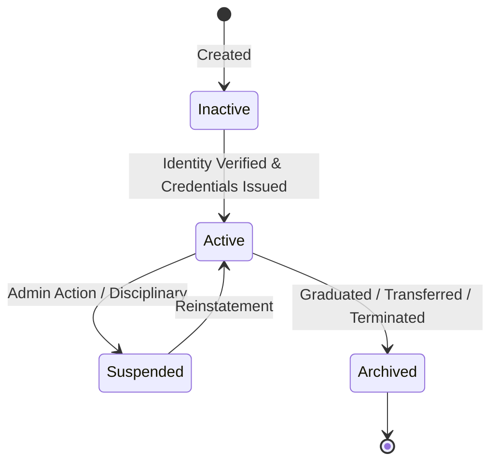
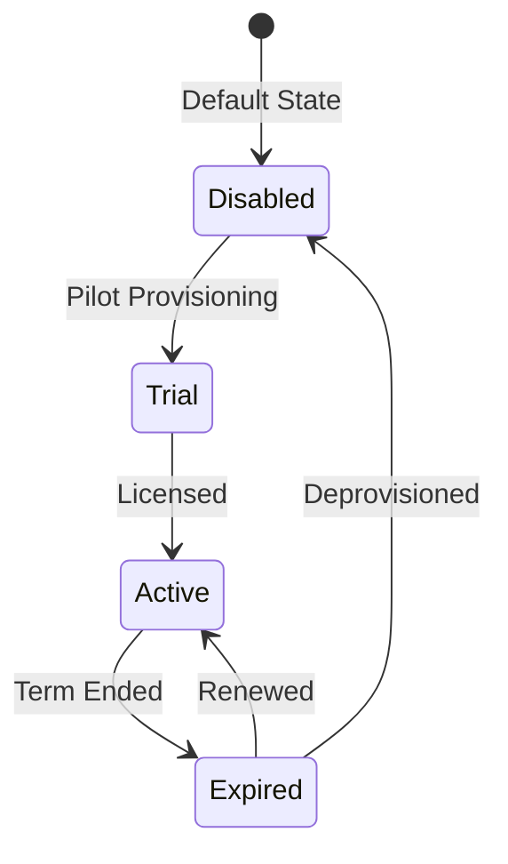

# Phase 01 Plan: Shared Platform Foundation and Safe Execution Boundary

## Status
- [ ] NOT_STARTED
- [ ] IN_PROGRESS
- [x] PASSED
- [ ] FAILED
- [ ] BLOCKED

---

## 1. Objective and user value

Establish an authoritative, hardened platform foundation that bridges the existing AI tutoring core with the incoming School ERP suite. Guarantee deterministic database lifecycle, fail-fast production startup validation, canonical multi-tenant identity and RBAC boundaries, shared Person/Student/Guardian/Staff data contracts, structured error handling, domain event outbox conventions, and feature entitlement controls before any domain-specific ERP features are built.

---

## 2. Scope

### In-scope:
1. **Configuration & Startup Hardening:**
   - Enhance `validate_production_config` to deliver actionable diagnostics when configured database files are missing (`DEF-P00-01`).
   - Validate that production mode strictly disallows mock AI adapters, insecure JWT keys, unencrypted session storage, and wildcard CORS.
2. **Shared Identity & Institution Domain Model:**
   - Establish canonical shared identity entities in `central_platform/models/identity.py`:
     - `Person` (base identity with contact, name, demographic attributes).
     - `StudentProfile` (admission reference, roll number, academic status).
     - `GuardianProfile` (relationship type, contact preferences, legal guardian flag).
     - `StudentGuardianLink` (pickup authorization, portal access, notification preferences).
     - `StaffProfile` (employee ID, department, designation, employment status).
   - Author SQL migration `009_shared_identity_and_entitlements.sql` with safe up/down scripts.
3. **Feature Entitlements & Module Flags:**
   - Implement `ModuleEntitlement` model and enforcement middleware (`central_platform/entitlements/`).
   - Block unentitled ERP modules with clean `403 Forbidden` / `FEATURE_NOT_ENTITLED` responses rather than synthetic mock successes.
4. **Domain Event Outbox & Idempotency Standard:**
   - Define canonical outbox event conventions (`idempotency_key`, `event_type`, `aggregate_id`, `payload`, `correlation_id`).
5. **API Route Security & Structured Error Schema:**
   - Verify every existing and new API endpoint enforces authentication, role checking, and tenant scoping (`organization_id`).
   - Standardize error responses to include `error_code`, `message`, `correlation_id`, and `details`.

### Exclusions:
- Implementing domain-specific ERP workflows like fee collection, attendance marking, or timetable generation (reserved for Phases 02B through 06).
- Altering core AI model weights or Socratic prompt templates.

---

## 3. Repository Discovery

- **Configuration:** `central_platform/config.py` (`PlatformSettings`, `validate_production_config`).
- **Database Layer:** `central_platform/db.py` (`PlatformDatabase`), `migrations/` (`001` through `008`).
- **Auth & RBAC:** `central_platform/auth/tokens.py`, `central_platform/rbac/engine.py`.
- **API Surface:** `central_platform/api/app.py`, 22 routers under `/api/v1/*`.

---

## 4. Requirements and Traceability

- `REQ-P01-01`: Configuration consolidation and production startup validation with enhanced database diagnostics (`DEF-P00-01`).
- `REQ-P01-02`: Canonical shared identity data model (`Person`, `StudentProfile`, `GuardianProfile`, `StudentGuardianLink`, `StaffProfile`).
- `REQ-P01-03`: Multi-tenant organization boundaries and RBAC policy enforcement.
- `REQ-P01-04`: Migration lifecycle hardening with migration `009` and reversible down script.
- `REQ-P01-05`: Module entitlement engine preventing mock fallbacks for disabled modules.

---

## 5. Business Workflow and State Machine

### Identity & Enrollment Lifecycle

### Module Entitlement Lifecycle

---

## 6. Data and Migration Plan

Create `migrations/009_shared_identity_and_entitlements.sql`:
1. `persons` — Universal physical individual record.
2. `student_profiles` — Extends `persons` with academic details.
3. `guardian_profiles` — Extends `persons` with guardian metadata.
4. `student_guardian_links` — Many-to-many junction with pickup/portal privileges.
5. `staff_profiles` — Extends `persons` with employment metadata.
6. `module_entitlements` — Tenant-level feature toggle and module activation ledger.
7. `domain_events_outbox` — Transactional outbox for guaranteed event delivery.
Create matching `migrations/009_shared_identity_and_entitlements_down.sql`.

---

## 7. API / Client Contract

New Foundation Endpoints:
- `GET /api/v1/entitlements` — List enabled modules for the authenticated tenant.
- `GET /api/v1/identity/persons/{person_id}` — Retrieve person profile (role-scoped).
- `GET /api/v1/identity/students/{student_id}/guardians` — Retrieve authorized guardians.
- `POST /api/v1/identity/students/{student_id}/guardians` — Link guardian with authorization flags.

---

## 8. Threat Model and Privacy

- **Threat:** Cross-tenant leakage of student/guardian PII.
  - **Mitigation:** Enforce `organization_id` check in database query and API dependencies.
- **Threat:** Unentitled module usage or mock spoofing.
  - **Mitigation:** `require_entitlement(module_name)` dependency returns `403` with structured error code.
- **Threat:** PII exposure in logs.
  - **Mitigation:** Exclude national IDs, phone numbers, and addresses from structured logging payloads.

---

## 9. Implementation Sequence

1. Write focused test cases in `tests/test_phase01_shared_platform_foundation.py`.
2. Update `central_platform/config.py` to harden `resolve_database_path` diagnostic message.
3. Author migration `009_shared_identity_and_entitlements.sql` and down script.
4. Implement dataclasses and repository methods in `central_platform/models/identity.py` and `central_platform/db.py`.
5. Implement entitlement manager and middleware in `central_platform/entitlements/manager.py`.
6. Implement identity routes in `central_platform/api/routes/identity.py` and mount in `central_platform/api/app.py`.
7. Execute focused tests, fix any defects, and run full regression.
8. Certify Phase 01 exit gate.

---

## 10. Test Plan Written Before Implementation

- `test_database_resolution_diagnostic_message`: Asserts actionable guidance on missing DB.
- `test_migration_009_up_and_down`: Verifies forward and rollback migration.
- `test_shared_identity_creation_and_linking`: Validates student-guardian linkage and pickup flags.
- `test_cross_tenant_identity_isolation`: Confirms that Org A cannot view Org B student or guardian.
- `test_module_entitlement_enforcement`: Proves unentitled modules return 403, not mock success.
- `test_full_platform_regression`: Verifies zero regression in the 1,562 existing tests.

---

## 11. Observability and Support

- Log all entitlement checks and schema migration runs with correlation IDs.
- Record structured metrics for active tenants and licensed modules.

---

## 12. Rollout and Rollback

- Migration 009 is fully reversible using `009_shared_identity_and_entitlements_down.sql`.
- Feature entitlements default to `false` for new ERP modules, ensuring zero impact on existing AI tutor flows.

---

## 13. Exit Criteria

- [x] `test_phase01_shared_platform_foundation.py` passes 100%.
- [x] Database path diagnostic enhancement verified.
- [x] Migration 009 applied cleanly on top of 001–008 and proven reversible.
- [x] Shared identity and guardian linking models runtime verified with tenant isolation.
- [x] Entitlement gate proven to block unentitled modules.
- [x] Full regression suite remains 100% green (1,568 tests passed).

---

## 14. Execution Evidence

- Evidence file: `docs/development/evidence/phase01/phase01_test_execution.log`

---

## 15. Final Result

**PASSED**. All deliverables, migrations, domain models, services, entitlement gating, and full platform regression (1,568 passing tests, 0 failures) verified. Certified on 2026-10-14.
