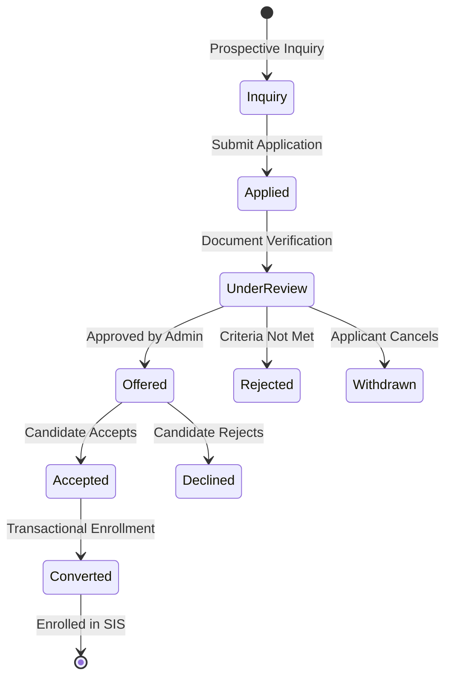
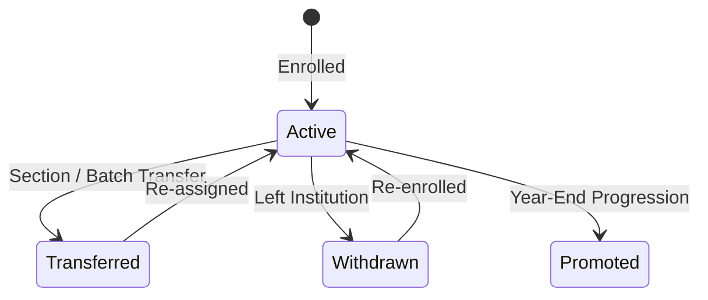

# Phase 02B Plan: Core ERP Foundation and Student Information System (SIS & Admissions)

## Status
- [ ] NOT_STARTED
- [ ] IN_PROGRESS
- [x] PASSED
- [ ] FAILED
- [ ] BLOCKED

---

## 1. Objective and User Value

Deliver a robust, real-data-backed core School Operations Foundation comprising:
1. **Academic Calendar & Structure:** Configurable Academic Years, Terms, and Calendar Events for both K-12 schools and coaching institutes.
2. **Admissions CRM:** Public inquiry intake with rate limiting and input sanitization, formal application submission, document attachment/verification, review workflow, offer issuance, and transactional conversion to enrolled students.
3. **Student Information System (SIS):** Canonical student directory, class/section/batch management, student-class enrollments with effective dates, guardian links with pickup and communication flags, and lifecycle transitions (active, transferred, withdrawn, promoted).

All entities are tenant-isolated (`organization_id`), auditable, and backed by durable SQLite/Postgres schemas with transactional conversion semantics preventing duplicate account generation upon retry.

---

## 2. Scope

### In-scope:
1. **Academic Structure & Calendar:**
   - Entities: `academic_years`, `academic_terms`, `school_calendar_events`.
   - Support active year designation, term date boundaries, holiday flagging.
2. **Admissions CRM:**
   - Entities: `admission_inquiries`, `admission_applications`, `admission_documents`, `admission_offers`.
   - Public inquiry endpoint with rate-limiting and validation.
   - Application stage transitions: `DRAFT` -> `SUBMITTED` -> `UNDER_REVIEW` -> `OFFERED` -> `ACCEPTED` -> `CONVERTED` (or `REJECTED`, `WITHDRAWN`).
   - Idempotent conversion of `ACCEPTED` application into `Person`, `StudentProfile`, `GuardianProfile`, `StudentGuardianLink`, and `ClassEnrollment`.
   - Duplicate detection (matching email, phone, applicant name) to prevent duplicate profiles.
3. **Student Information System (SIS):**
   - Entities: `student_classes`, `student_class_enrollments`.
   - Class/batch capacity constraints, class teacher assignment.
   - Student roster queries with role-based access control.
   - Lifecycle operations: deactivate, transfer, withdraw, archive, re-enroll.
4. **Database & Migrations:**
   - Migration `010_admissions_and_academic_calendar.sql` and reversible down script.
5. **API Routes:**
   - `/api/v1/academic/*` (academic years, terms, calendar events).
   - `/api/v1/admissions/*` (inquiries, applications, documents, offers, conversions).
   - `/api/v1/sis/*` (classes, rosters, student enrollments, status transitions).
6. **Entitlement & RBAC Enforcement:**
   - Require `admissions`, `sis`, and `academic` entitlements.

### Exclusions:
- Attendance tracking, timetable generation, and messaging (reserved for Phase 03).
- Fee collection and payment gateway integration (reserved for Phase 05).

---

## 3. Repository Discovery

- Database Engine: `central_platform/db.py` (`PlatformDatabase`).
- Migrations: `migrations/` (`001` through `009`).
- Identity Models: `central_platform/models/identity.py`.
- Entitlements: `central_platform/entitlements/manager.py`.
- API Application: `central_platform/api/app.py`.
- Auth & RBAC: `central_platform/auth/dependencies.py`, `central_platform/rbac/engine.py`.

---

## 4. Requirements and Traceability

- `REQ-P02B-01`: Multi-tenant Academic Year, Term, and Calendar Event schema and services (`DEVELOPMENT.md` §6.1, §7 Phase 02B).
- `REQ-P02B-02`: Public inquiry intake with rate-limiting, sanitization, and tenant isolation (`DEVELOPMENT.md` §4, §6.3, §7 Phase 02B).
- `REQ-P02B-03`: Formal application processing, document verification, and offer management (`DEVELOPMENT.md` §6.3, §15.1).
- `REQ-P02B-04`: Transactional, idempotent admission-to-student conversion (`DEVELOPMENT.md` §5.4, §6.2, §7 Phase 02B).
- `REQ-P02B-05`: Class/section and batch management with capacity limits (`DEVELOPMENT.md` §6.2, §15.2).
- `REQ-P02B-06`: Student class enrollment with effective dates and lifecycle audit transitions (`DEVELOPMENT.md` §6.2, §7 Phase 02B).
- `REQ-P02B-07`: Duplicate applicant detection and review workflow (`DEVELOPMENT.md` §6.3, §7 Phase 02B).

---

## 5. Business Workflow and State Machine

### Admissions Intake & Lifecycle

### Student Class Enrollment Lifecycle

---

## 6. Data and Migration Plan

Create `migrations/010_admissions_and_academic_calendar.sql`:
1. `academic_years` (id, organization_id, name, code, start_date, end_date, is_current, status, created_at, updated_at).
2. `academic_terms` (id, organization_id, academic_year_id, name, code, start_date, end_date, status, created_at, updated_at).
3. `school_calendar_events` (id, organization_id, academic_year_id, event_type, title, description, start_date, end_date, is_holiday, created_at).
4. `admission_inquiries` (id, organization_id, inquiry_number, applicant_name, guardian_name, email, phone, target_grade, status, notes, created_at, updated_at).
5. `admission_applications` (id, organization_id, application_number, inquiry_id, academic_year_id, applicant_name, date_of_birth, gender, email, phone, address, previous_school, target_grade, status, review_notes, decision_date, decision_by, converted_student_id, created_at, updated_at).
6. `admission_documents` (id, organization_id, application_id, document_type, file_name, file_path, file_hash, verification_status, verified_by, verified_at, created_at).
7. `admission_offers` (id, organization_id, application_id, offer_date, valid_until, grade, fee_amount, conditions, status, created_at, updated_at).
8. `student_classes` (id, organization_id, academic_year_id, name, grade_level, section, capacity, class_teacher_id, created_at, updated_at).
9. `student_class_enrollments` (id, organization_id, student_id, class_id, academic_year_id, roll_number, enrollment_date, status, created_at, updated_at).

Create matching `migrations/010_admissions_and_academic_calendar_down.sql`.

---

## 7. API / Client Contract

- `POST /api/v1/academic/years` — Create academic year (Admin).
- `GET /api/v1/academic/years` — List academic years for tenant.
- `POST /api/v1/academic/terms` — Create term in academic year.
- `GET /api/v1/academic/terms` — List terms.
- `POST /api/v1/academic/events` — Add calendar event / holiday.
- `GET /api/v1/academic/events` — List calendar events.
- `POST /api/v1/admissions/inquiries` — Submit public inquiry (rate-limited).
- `GET /api/v1/admissions/inquiries` — List inquiries (Admin/Staff).
- `POST /api/v1/admissions/applications` — Submit application.
- `GET /api/v1/admissions/applications` — List applications.
- `GET /api/v1/admissions/applications/{app_id}` — Get application details.
- `POST /api/v1/admissions/applications/{app_id}/documents` — Attach document.
- `POST /api/v1/admissions/applications/{app_id}/status` — Transition application status.
- `POST /api/v1/admissions/applications/{app_id}/offer` — Issue admission offer.
- `POST /api/v1/admissions/applications/{app_id}/convert` — Convert accepted application to enrolled student.
- `POST /api/v1/sis/classes` — Create class / section.
- `GET /api/v1/sis/classes` — List classes.
- `GET /api/v1/sis/classes/{class_id}/roster` — Get student roster.
- `POST /api/v1/sis/classes/{class_id}/enroll` — Enroll student in class.
- `POST /api/v1/sis/enrollments/{enrollment_id}/status` — Update enrollment status (transfer/withdraw).

---

## 8. Threat Model and Privacy

- **Public Form Abuse:** Rate limiting (e.g. max 5 inquiries per IP/hour), honeypot, schema validation, email sanitization.
- **Tenant Isolation:** Every query enforces `WHERE organization_id = :org_id`.
- **PII Protection:** Applicant date of birth, contact details, and documents restricted to authorized admissions staff and org admin.
- **Transactional Conversion Safety:** Database transactions prevent orphaned records or duplicate students if conversion fails mid-operation.

---

## 9. Implementation Sequence

1. Write focused test suite `tests/test_phase02b_core_erp_sis_admissions.py`.
2. Author Migration 010 SQL (`migrations/010_admissions_and_academic_calendar.sql`) and down script.
3. Implement domain models in `central_platform/models/admissions.py` and `central_platform/models/academic.py`.
4. Implement database methods in `central_platform/db.py`.
5. Implement domain services: `central_platform/admissions/service.py` and `central_platform/academic/service.py`.
6. Implement API routes: `central_platform/api/routes/admissions.py`, `central_platform/api/routes/academic.py`, `central_platform/api/routes/sis.py`.
7. Register routes in `central_platform/api/app.py`.
8. Execute focused test suite and verify 100% pass rate.
9. Execute migration hardening and full platform regression suite.
10. Certify Phase 02B exit gate.

---

## 10. Test Plan Written Before Implementation

- `test_academic_calendar_lifecycle`: Year, term, and holiday event creation and constraints.
- `test_admission_inquiry_and_duplicate_detection`: Inquiry intake and duplicate flagging.
- `test_application_stage_workflow`: Stage progression from draft to offer to accepted.
- `test_idempotent_admission_conversion`: Transactional conversion to student, guardian, and enrollment without duplicates on retry.
- `test_sis_class_roster_and_capacity_limits`: Class creation, capacity enforcement, and roster retrieval.
- `test_student_lifecycle_transitions`: Status transitions (active, transferred, withdrawn).
- `test_cross_tenant_isolation_erp`: Positive and negative tenant access assertions.

---

## 11. Observability, Audit and Support

- Record all admission stage changes, offers, and conversions in `audit_events` or domain events outbox.
- Structured logging with correlation IDs on all public and authenticated endpoints.

---

## 12. Rollout, Flag and Rollback Strategy

- Reversible migration: `010_admissions_and_academic_calendar_down.sql`.
- Entitlement flags: `admissions`, `sis`, and `academic` default to enabled only for organizations that have purchased the ERP package.

---

## 13. Exit Criteria

- [x] `test_phase02b_core_erp_sis_admissions.py` passes 100%.
- [x] Migration 010 applies cleanly and rolls back cleanly.
- [x] End-to-end admission-to-student-to-class journey verified with real database records.
- [x] Duplicate submit/retry verified idempotent.
- [x] Capacity and tenant isolation rules verified.
- [x] Full regression suite remains 100% green (1,576/1,576 passed).

---

## 14. Execution Evidence

- Evidence file: `docs/development/evidence/phase02b/phase02b_test_execution.log`

---

## 15. Final Result

**PASSED**. All deliverables, migrations, domain models, services, APIs, and platform regression (1,576 passed, 0 failures) verified on 2026-10-14.
