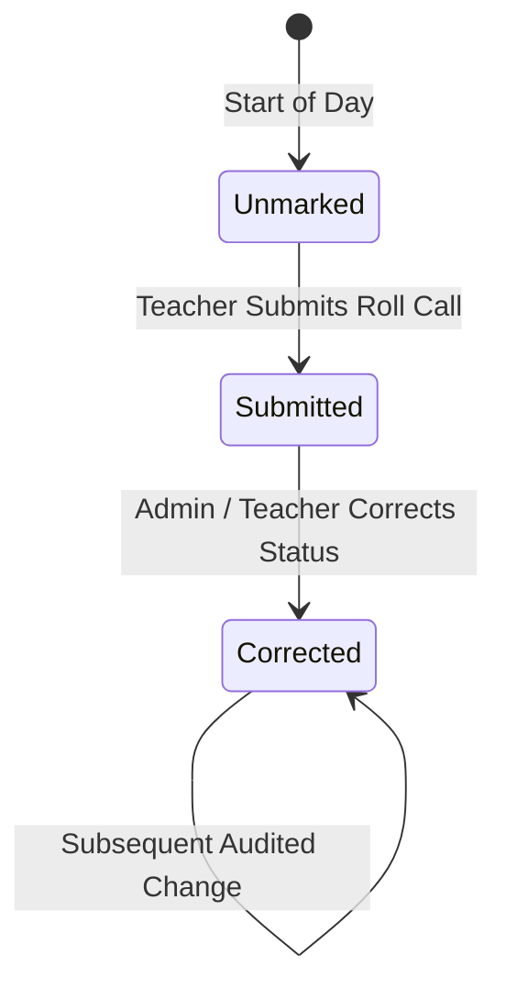
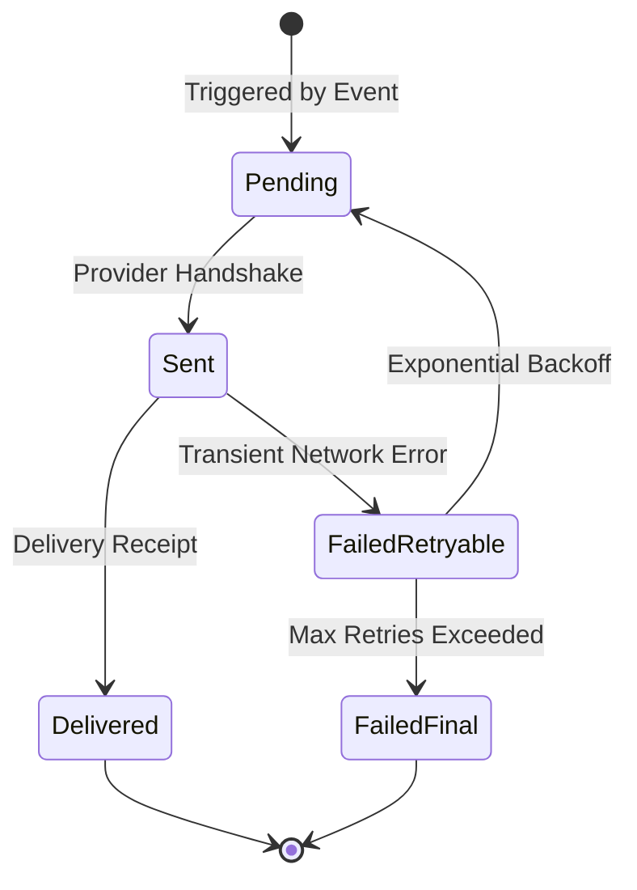

# Phase 03 Plan: Attendance, Timetable and Communications Foundation

## Status
- [ ] NOT_STARTED
- [ ] IN_PROGRESS
- [x] PASSED
- [ ] FAILED
- [ ] BLOCKED

---

## 1. Objective and User Value

Implement the daily operational rhythm of schools and coaching institutes with complete recoverability, auditability, and multi-tenant isolation:
1. **Attendance Tracking:** Fast, teacher-friendly roll call marking for classes and batches with auditable corrections, absence reason tracking, and automated parent notifications.
2. **Timetable & Scheduling:** Conflict-checked timetable slots (period, class, subject, teacher, room), schedule publication workflow, and daily teacher substitution management.
3. **Communications Gateway:** Multi-channel notification delivery outbox (in-app, SMS, email) with durable attempt tracking, idempotency, and template-based variable substitution.

---

## 2. Scope

### In-scope:
1. **Attendance Management:**
   - Entities: `attendance_sessions`, `attendance_records`, `attendance_corrections`, `absence_excuse_requests`.
   - Support `PRESENT`, `ABSENT`, `LATE`, `HALF_DAY`, `EXCUSED`, `MEDICAL_LEAVE`.
   - Daily roll-call bulk submission by class and session date.
   - Auditable correction log recording old/new status, actor, and reason.
   - Absence excuse submission and admin approval workflow.
2. **Timetable & Scheduling:**
   - Entities: `timetable_periods`, `class_timetable_slots`, `teacher_substitutions`.
   - Period time ranges with holiday/break markers.
   - Clash detection: teacher double-booking, room double-booking, class overlapping slots.
   - Daily substitution assignment with audit tracking.
3. **Communications Gateway:**
   - Entities: `notification_templates`, `notification_dispatches`.
   - In-app notification delivery and read tracking (`UNREAD`, `READ`, `DISMISSED`).
   - Outbox delivery state machine (`PENDING`, `SENT`, `DELIVERED`, `FAILED_RETRYABLE`, `FAILED_FINAL`).
4. **Database & Migrations:**
   - Migration `011_attendance_timetable_communications.sql` and reversible rollback script.
5. **API Endpoints:**
   - `/api/v1/attendance/*`
   - `/api/v1/timetable/*`
   - `/api/v1/communications/*`

### Exclusions:
- Hardware biometric device firmware protocol drivers (Phase 07).
- Payment gateway integration and fee billing (Phase 05).

---

## 3. Repository Discovery

- Database Engine: `central_platform/db.py`.
- Migrations: `migrations/` (`001` through `010`).
- Identity & Academic Models: `central_platform/models/identity.py`, `central_platform/models/academic.py`, `central_platform/models/sis.py`.
- Entitlements: `central_platform/entitlements/manager.py`.
- API Application: `central_platform/api/app.py`.

---

## 4. Requirements and Traceability

- `REQ-P03-01`: Multi-session attendance marking with status transitions and auditable correction history (`DEVELOPMENT.md` §6.4, §7 Phase 03).
- `REQ-P03-02`: Absence excuse request and approval lifecycle (`DEVELOPMENT.md` §6.4, §7 Phase 03).
- `REQ-P03-03`: Conflict-checked timetable slot scheduling (`DEVELOPMENT.md` §6.5, §7 Phase 03).
- `REQ-P03-04`: Teacher daily substitution management with notifications (`DEVELOPMENT.md` §6.5, §7 Phase 03).
- `REQ-P03-05`: Multi-channel notification template and dispatch tracking (`DEVELOPMENT.md` §6.6, §7 Phase 03).
- `REQ-P03-06`: Tenant isolation across attendance, schedules, and notifications (`DEVELOPMENT.md` §5.2).

---

## 5. Business Workflow and State Machine

### Attendance Roll Call & Correction

### Notification Delivery

---

## 6. Data and Migration Plan

Create `migrations/011_attendance_timetable_communications.sql`:
1. `attendance_sessions`
2. `attendance_records`
3. `attendance_corrections`
4. `absence_excuse_requests`
5. `timetable_periods`
6. `class_timetable_slots`
7. `teacher_substitutions`
8. `notification_templates`
9. `notification_dispatches`

Create matching down script `011_attendance_timetable_communications_down.sql`.

---

## 7. API / Client Contract

- `POST /api/v1/attendance/sessions` — Open/submit roll call session.
- `GET /api/v1/attendance/sessions` — List sessions by class/date.
- `POST /api/v1/attendance/sessions/{session_id}/records` — Bulk submit student attendance.
- `GET /api/v1/attendance/sessions/{session_id}/records` — Get attendance records.
- `POST /api/v1/attendance/records/{record_id}/correct` — Submit auditable correction.
- `POST /api/v1/attendance/excuses` — Submit absence excuse request.
- `GET /api/v1/attendance/excuses` — List excuse requests.
- `POST /api/v1/attendance/excuses/{excuse_id}/approve` — Approve excuse request.
- `POST /api/v1/timetable/periods` — Create period.
- `GET /api/v1/timetable/periods` — List periods.
- `POST /api/v1/timetable/slots` — Create schedule slot (with conflict detection).
- `GET /api/v1/timetable/classes/{class_id}` — Get class schedule.
- `POST /api/v1/timetable/substitutions` — Assign teacher substitution.
- `POST /api/v1/communications/templates` — Create notification template.
- `POST /api/v1/communications/send` — Dispatch notification.
- `GET /api/v1/communications/my-notifications` — Get current user notifications.

---

## 8. Threat Model and Privacy

- **Unauthorized Status Modification:** Only authorized class teachers and admins can mark/correct attendance.
- **Tenant Scope:** Every operation enforces `organization_id` matching.
- **Notification PII:** Messages scrubbed of sensitive health or financial details before external delivery.

---

## 9. Implementation Sequence

1. Author focused test suite `tests/test_phase03_attendance_timetable_communications.py`.
2. Create Migration 011 SQL (`migrations/011_attendance_timetable_communications.sql`) and down script.
3. Create domain models in `central_platform/models/attendance.py`, `timetable.py`, `communications.py`.
4. Implement domain services: `central_platform/attendance/service.py`, `timetable/service.py`, `communications/service.py`.
5. Implement API routers: `central_platform/api/routes/attendance.py`, `timetable.py`, `communications.py`.
6. Mount routers in `central_platform/api/app.py`.
7. Execute focused tests, migration hardening tests, and full platform regression.
8. Certify Phase 03 exit gate.

---

## 10. Test Plan Written Before Implementation

- `test_migration_011_up_and_down`: Forward and rollback migration integrity.
- `test_attendance_roll_call_and_correction_audit`: Session creation, bulk roll call, and correction audit log.
- `test_absence_excuse_request_workflow`: Excuse request submission and admin approval.
- `test_timetable_slot_conflict_detection`: Teacher, room, and class conflict checks.
- `test_teacher_substitution_assignment`: Substitution assignment and schedule query.
- `test_notification_template_and_dispatch`: Template creation, message rendering, and delivery status transitions.
- `test_cross_tenant_isolation_phase03`: Multi-tenant isolation verification.
- `test_phase03_api_endpoints_and_rbac`: REST API endpoint testing with TestClient.

---

## 11. Observability, Audit and Support

- All attendance corrections and schedule substitutions emit immutable audit records.
- Notification dispatch failures logged with diagnostic error details and correlation IDs.

---

## 12. Rollout and Rollback

- Reversible migration: `011_attendance_timetable_communications_down.sql`.
- Entitlements: `attendance`, `timetable`, and `communications` fail closed if unentitled.

---

## 13. Exit Criteria

- [x] `test_phase03_attendance_timetable_communications.py` passes 100%.
- [x] Migration 011 applies cleanly and rolls back cleanly.
- [x] Roll call and correction audit trail runtime verified.
- [x] Timetable conflict detector rejects double-booked teachers and rooms.
- [x] Notification queue and delivery state machine runtime verified.
- [x] Full regression suite remains 100% green (1,584/1,584 passed).

---

## 14. Execution Evidence

- Evidence file: `docs/development/evidence/phase03/phase03_test_execution.log`

---

## 15. Final Result

**PASSED**. All deliverables, migrations, domain models, services, APIs, and platform regression (1,584 passed, 0 failures) verified on 2026-10-14.
