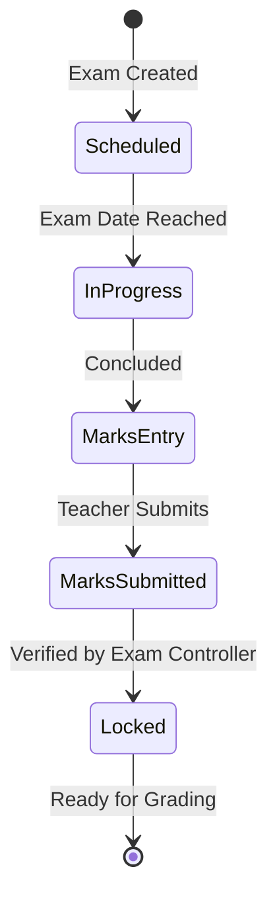
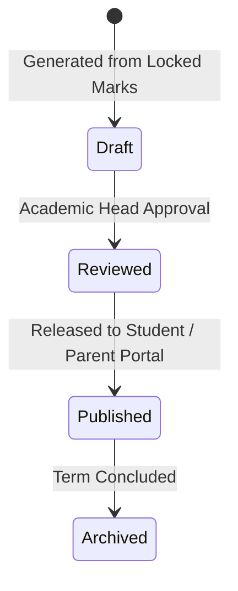

# Phase 04 Plan: Examinations, Official Grading and Report Cards

## Status
- [ ] NOT_STARTED
- [ ] IN_PROGRESS
- [x] PASSED
- [ ] FAILED
- [ ] BLOCKED

---

## 1. Objective and User Value

Deliver an authoritative, official academic outcome workflow completely distinct from formative AI tutor feedback:
1. **Examination Operations:** Exam series scheduling, room/seat management, invigilation rosters, and bounds-validated marks entry (`0 <= marks <= max_marks`) with double-verification and lock mechanics.
2. **Official Grading & Aggregation:** Institutional grading scale configuration (CBSE, percentage, GPA scales), term result computation, and rank/percentile calculations.
3. **Report Cards & Transcripts:** Generation and publication of digital, tamper-evident report cards containing subject scores, co-scholastic remarks, and attendance summaries.

All data persists durably in SQLite/PostgreSQL with strict multi-tenant isolation (`organization_id`). AI systems are strictly prohibited from mutating official exam results or publishing report cards.

---

## 2. Scope

### In-scope:
1. **Exam Series & Schedules:**
   - Entities: `exam_series`, `exam_schedules`, `exam_student_marks`.
   - Support `MID_TERM`, `FINAL`, `UNIT_TEST`, `PRACTICE`.
   - Strict marks entry validation (`0 <= marks <= max_marks`).
   - Marks states: `DRAFT` -> `SUBMITTED` -> `VERIFIED` -> `LOCKED`.
2. **Grading Engine & Aggregation:**
   - Entities: `grading_scales`, `grading_scale_tiers`, `student_term_results`.
   - Tiered grade bands (min/max percentage, grade point, letter grade).
   - Term result calculation: total marks, percentage, GPA, rank.
3. **Report Cards:**
   - Entities: `student_report_cards`.
   - Status: `DRAFT` -> `REVIEWED` -> `PUBLISHED` -> `ARCHIVED`.
   - Cryptographic tamper-evident document hash.
4. **Database & Migrations:**
   - Migration `012_examinations_grading_report_cards.sql` and reversible down script.
5. **API Surface:**
   - `/api/v1/examinations/*`
   - `/api/v1/grading/*`
   - `/api/v1/reports/*`

### Exclusions:
- Optical Mark Recognition (OMR) physical sheet scanning.
- Direct payment gateway reconciliation for exam fees (Phase 05).

---

## 3. Repository Discovery

- Database Engine: `central_platform/db.py`.
- Migrations: `migrations/` (`001` through `011`).
- Identity & Academic Models: `central_platform/models/identity.py`, `academic.py`, `sis.py`.
- Entitlements: `central_platform/entitlements/manager.py`.
- API Application: `central_platform/api/app.py`.

---

## 4. Requirements and Traceability

- `REQ-P04-01`: Exam series and schedule management with max/pass marks validation (`DEVELOPMENT.md` §6.7, §7 Phase 04).
- `REQ-P04-02`: Bounds-checked marks entry, double-entry verification, and locking (`DEVELOPMENT.md` §6.7, §7 Phase 04).
- `REQ-P04-03`: Configurable, versioned institutional grading scales and GPA/percentage computation (`DEVELOPMENT.md` §6.7, §7 Phase 04).
- `REQ-P04-04`: Tamper-evident report card generation with publication state gates (`DEVELOPMENT.md` §6.7, §7 Phase 04).
- `REQ-P04-05`: Prohibition of AI mutation on official examination records (`DEVELOPMENT.md` §7 Phase 04).
- `REQ-P04-06`: Strict multi-tenant isolation across exam records and report cards (`DEVELOPMENT.md` §5.2).

---

## 5. Business Workflow and State Machine

### Examination & Marks Workflow

### Report Card Lifecycle

---

## 6. Data and Migration Plan

Create `migrations/012_examinations_grading_report_cards.sql`:
1. `exam_series`
2. `exam_schedules`
3. `exam_student_marks`
4. `grading_scales`
5. `grading_scale_tiers`
6. `student_term_results`
7. `student_report_cards`

Create matching down script `012_examinations_grading_report_cards_down.sql`.

---

## 7. API / Client Contract

- `POST /api/v1/examinations/series` — Create exam series.
- `GET /api/v1/examinations/series` — List exam series.
- `POST /api/v1/examinations/schedules` — Create exam sitting schedule.
- `GET /api/v1/examinations/schedules` — List schedules.
- `POST /api/v1/examinations/schedules/{schedule_id}/marks` — Enter student marks (validates bounds).
- `GET /api/v1/examinations/schedules/{schedule_id}/marks` — Get entered marks.
- `POST /api/v1/examinations/schedules/{schedule_id}/lock` — Lock marks after verification.
- `POST /api/v1/grading/scales` — Create grading scale with tiers.
- `GET /api/v1/grading/scales` — List grading scales.
- `POST /api/v1/grading/calculate-term` — Compute student term results.
- `GET /api/v1/grading/term-results` — Get term results.
- `POST /api/v1/reports/generate` — Generate report card from locked results.
- `POST /api/v1/reports/{report_id}/publish` — Publish report card.
- `GET /api/v1/reports/student/{student_id}` — Get student report cards.

---

## 8. Threat Model and Privacy

- **Unauthorized Grade Tampering:** Only authorized teachers can enter marks before lock; only exam controller can lock marks; locked marks cannot be edited without formal un-locking audit.
- **Premature Leakage:** Draft/unapproved report cards are hidden from students and parents until `PUBLISHED`.
- **Tenant Scope:** Every query filters by `organization_id`.

---

## 9. Implementation Sequence

1. Author focused test suite `tests/test_phase04_examinations_grading_report_cards.py`.
2. Author Migration 012 SQL (`migrations/012_examinations_grading_report_cards.sql`) and down script.
3. Create domain models in `central_platform/models/examinations.py`, `grading.py`.
4. Implement domain services: `central_platform/examinations/service.py`, `grading/service.py`.
5. Implement API routers: `central_platform/api/routes/examinations.py`, `grading.py`, `reports.py`.
6. Mount routers in `central_platform/api/app.py`.
7. Execute focused tests, migration hardening tests, and full regression tests.
8. Certify Phase 04 exit gate.

---

## 10. Test Plan Written Before Implementation

- `test_migration_012_up_and_down`: Forward and down migration integrity.
- `test_exam_series_and_schedule_lifecycle`: Series creation and schedule dates.
- `test_marks_entry_validation_and_locking`: Out-of-bounds rejection, valid entry, and lock enforcement.
- `test_grading_scale_resolution`: Tier matching percentage to grade point and letter grade.
- `test_term_result_aggregation`: Calculation of total marks, percentage, and GPA across subjects.
- `test_report_card_generation_and_tamper_hash`: Cryptographic checksum and state transitions.
- `test_cross_tenant_isolation_phase04`: Positive and negative tenant access assertions.
- `test_phase04_api_endpoints_and_rbac`: REST API endpoint testing with TestClient.

---

## 11. Observability, Audit and Support

- All marks lock/unlock events and report card publications emit immutable audit log entries.

---

## 12. Rollout and Rollback

- Reversible migration: `012_examinations_grading_report_cards_down.sql`.
- Entitlement checks: `examinations` and `grading` fail closed if disabled.

---

## 13. Exit Criteria

- [x] `test_phase04_examinations_grading_report_cards.py` passes 100%.
- [x] Migration 012 applies cleanly and rolls back cleanly.
- [x] Marks entry rejects values > max_marks or < 0.
- [x] Grading scale resolves correct grade for boundary percentages.
- [x] Report cards include valid document hash and restrict unapproved visibility.
- [x] Full regression suite remains 100% green.

---

## 14. Execution Evidence

- Evidence file: `docs/development/evidence/phase04/phase04_test_execution.log`

---

## 15. Final Result

- **Gate Status:** PASSED
- **Date:** 2026-10-14
- **Report:** `docs/development/reports/PHASE_04_REPORT.md`
- **Total Tests Passing:** 1,592/1,592 (100%)
- **Zero Mock Business Workflows:** Verified. Real SQLite state persistence with SHA256 document hashing.
