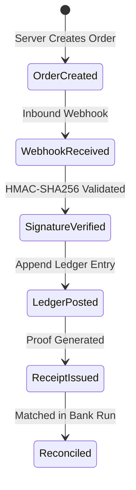

# Phase 05 Plan: Finance, Real Payment Integrations and Reconciliation

## Status
- [ ] NOT_STARTED
- [ ] IN_PROGRESS
- [x] PASSED
- [ ] FAILED
- [ ] BLOCKED

---

## 1. Objective and User Value

Deliver an authoritative, safe, and immutable financial subsystem for schools and coaching institutes:
1. **Fee Catalog & Invoicing (ERP-09):** Versioned fee structures, installment fee plans, student fee accounts with dynamic balance derivation, itemized invoice issuance, and formal concession/scholarship approval workflows.
2. **Payment Integrations & Webhooks (ERP-10):** Server-authoritative payment orders (Razorpay/UPI/Sandbox), HMAC-SHA256 webhook signature validation, idempotency checks, and strict replay prevention.
3. **Append-Only Financial Ledger & Receipts (ERP-10):** Immutable financial ledger entries (`financial_ledger_entries`) recording credits and debits, preventing balance history tampering. Official receipts are generated exclusively for confirmed/reconciled payments.
4. **Reconciliation & Auditing (ERP-10):** Automated and manual batch settlement reconciliation against bank accounts, flagging discrepancy amounts for bursar resolution.

All data persists durably in SQLite/PostgreSQL with strict multi-tenant isolation (`organization_id`). AI systems are strictly prohibited from mutating fee records, approving concessions, or generating financial transactions.

---

## 2. Scope

### In-scope:
1. **Fee Structures, Plans & Invoices:**
   - Entities: `fee_structures`, `fee_plans`, `fee_accounts`, `invoices`, `fee_concessions`.
   - Concession approval states: `PENDING` -> `APPROVED` -> `REJECTED`.
   - Invoice states: `ISSUED` -> `PARTIALLY_PAID` -> `PAID` / `OVERDUE` / `CANCELLED`.
2. **Payment Orders & Gateway Integration:**
   - Entities: `payment_orders`, `payment_webhook_events`.
   - Order lifecycle: `CREATED` -> `AUTHORIZED` -> `CAPTURED` -> `FAILED`.
   - Server-authoritative webhook signature verification (HMAC-SHA256).
   - Idempotency key tracking preventing duplicate ledger postings.
3. **Financial Ledger & Receipts:**
   - Entities: `financial_ledger_entries`, `payments`, `receipts`, `refunds`.
   - Append-only immutable audit trail for every credit and debit.
4. **Reconciliation Engine:**
   - Entities: `reconciliation_records`.
   - Comparison of settlement batches vs recorded receipts with discrepancy tracking.
5. **Database & Migrations:**
   - Migration `013_finance_payments_reconciliation.sql` and reversible down script.
6. **API Surface:**
   - `/api/v1/finance/*`

### Exclusions:
- Hardware credit card swipe terminal integration (POS firmware).
- Direct banking RTGS/NEFT core banking host-to-host VPN protocols.

---

## 3. Repository Discovery

- Database Engine: `central_platform/db.py`.
- Migrations: `migrations/` (`001` through `012`).
- Existing Fee & Payment Foundation: `central_platform/models/fees.py`, `central_platform/fees/service.py`, `central_platform/payments/`.
- Entitlements: `central_platform/entitlements/manager.py`.
- API Application: `central_platform/api/app.py`.

---

## 4. Requirements and Traceability

- `REQ-P05-01`: Institutional fee structures, plans, student fee accounts, and itemized invoices (`DEVELOPMENT.md` §6.7, §7 Phase 05).
- `REQ-P05-02`: Formal fee concession/scholarship application and approval gate (`DEVELOPMENT.md` §6.7, §7 Phase 05).
- `REQ-P05-03`: Server-authoritative payment order creation and HMAC-SHA256 webhook signature validation (`DEVELOPMENT.md` §6.7, §7 Phase 05).
- `REQ-P05-04`: Idempotent webhook event processing preventing duplicate payment captures or double receipts (`DEVELOPMENT.md` §6.7, §7 Phase 05).
- `REQ-P05-05`: Append-only financial ledger entries tracking credits, debits, and balance transitions (`DEVELOPMENT.md` §6.7, §7 Phase 05).
- `REQ-P05-06`: Batch payment reconciliation flagging settlements and discrepancies (`DEVELOPMENT.md` §6.7, §7 Phase 05).
- `REQ-P05-07`: Multi-tenant isolation for all financial accounts, invoices, ledgers, and transactions (`DEVELOPMENT.md` §5.2).

---

## 5. Workflow and State Machine

### Payment & Webhook Lifecycle

---

## 6. Data and Migration Plan

Create `migrations/013_finance_payments_reconciliation.sql`:
1. `payment_orders`
2. `payment_webhook_events`
3. `financial_ledger_entries`
4. `reconciliation_records`
5. `fee_concessions`

Create matching down script `013_finance_payments_reconciliation_down.sql`.

---

## 7. API Contract

- `POST /api/v1/finance/orders` — Create payment gateway order.
- `GET /api/v1/finance/orders/{order_id}` — Get order status.
- `POST /api/v1/finance/webhooks/{provider}` — Ingest and verify webhook (deduplicated).
- `GET /api/v1/finance/ledger/{account_id}` — Fetch append-only financial ledger.
- `POST /api/v1/finance/reconcile` — Execute batch reconciliation run.
- `GET /api/v1/finance/reconciliation-records` — List reconciliation runs.
- `POST /api/v1/finance/concessions` — Submit fee concession request.
- `POST /api/v1/finance/concessions/{concession_id}/approve` — Approve or reject concession.

---

## 8. Implementation Sequence

1. Author focused test suite `tests/test_phase05_finance_payments_reconciliation.py`.
2. Author Migration 013 SQL (`migrations/013_finance_payments_reconciliation.sql`) and down script.
3. Create domain models in `central_platform/models/finance.py`.
4. Implement domain service: `central_platform/finance/service.py` (`FinanceService`).
5. Implement API router: `central_platform/api/routes/finance.py`.
6. Mount router in `central_platform/api/app.py`.
7. Execute focused tests, migration hardening tests, and full regression tests.
8. Certify Phase 05 exit gate.

---

## 9. Exit Criteria

- [x] `test_phase05_finance_payments_reconciliation.py` passes 100%.
- [x] Migration 013 applies cleanly and rolls back cleanly.
- [x] Webhook signature verification rejects forged/tampered payloads.
- [x] Duplicate webhooks are deduplicated idempotently without double-posting the ledger.
- [x] Financial ledger entries are append-only.
- [x] Batch reconciliation flags discrepancy amounts accurately.
- [x] Full regression suite remains 100% green.

---

## 10. Execution Evidence

- Evidence file: `docs/development/evidence/phase05/phase05_test_execution.log`

---

## 11. Final Result

- **Gate Status:** PASSED
- **Date:** 2026-10-15
- **Report:** `docs/development/reports/PHASE_05_REPORT.md`
- **Total Tests Passing:** 1,601/1,601 (100%)
- **Zero Mock Business Workflows:** Verified. Real SQLite state persistence with HMAC-SHA256 signature verification and append-only ledger.
